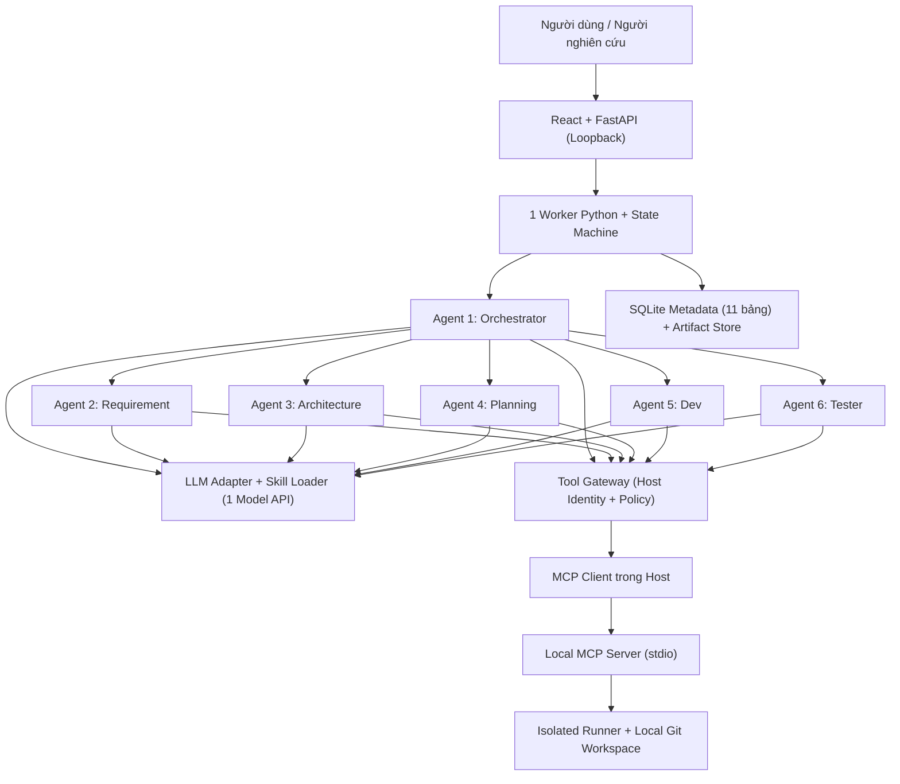

# ĐỀ CƯƠNG ĐỀ TÀI & CHỐT PHẠM VI MVP (P01)

> **Mã công việc**: `P01` (GitHub Issue `#2`, thuộc kế hoạch tổng `#1`)  
> **Trạng thái**: Đã duyệt phạm vi P01 ngày 23/11/2026 theo yêu cầu của chủ dự án trong chat; giữ lịch theo tuần tương đối. Đây là phê duyệt đề cương, chưa phải nghiệm thu hệ thống hay kết quả nghiên cứu.  
> **Nguồn chuẩn**: `Ke_hoach_nghien_cuu_he_thong_Multi_Agent.docx` (lập ngày 17/11/2026, 30 trang)  
> **SHA256 nguồn chuẩn**: `975228EA14EDCE90CFECBBFE05C9911DD33B35FD1A4ACEF75577A9499D884C9F`  
> **Mục tham chiếu**: Mục `1.2–1.6`, `2.8`, `3.3–3.6`, `4.3` và `5.1–5.2`

---

## 1. Thông tin chung & Mục tiêu đề tài

- **Tên đề tài**: *Nghiên cứu và xây dựng hệ thống Multi-Agent hỗ trợ tự động hóa quy trình phát triển phần mềm — Từ phân tích yêu cầu và thiết kế đến sinh mã, kiểm thử và sửa lỗi*.
- **Bản chất hệ thống**: Hệ thống multi-agent dựa trên workflow có điều phối tập trung (*workflow-based coordinated MAS*), có kiểm soát của con người tại các điểm duyệt xác định.
- **Mục tiêu tổng quát**: Nghiên cứu và xây dựng một nguyên mẫu có **đúng 6 vai trò logic** hỗ trợ tự động hóa một số hoạt động của quy trình phát triển phần mềm (phân tích yêu cầu → thiết kế → lập kế hoạch → sinh mã → kiểm thử → sửa lỗi có giới hạn) cho các ứng dụng web CRUD nhỏ, với đầy đủ bằng chứng thực thi và đánh giá đối chứng.
- **Mục tiêu cụ thể (kiểm chứng được)**:
  1. Giải thích được AI Agent, Multi-Agent System và ứng dụng trong kỹ nghệ phần mềm dựa trên tài liệu học thuật và tài liệu kỹ thuật chính thức.
  2. Thiết kế và hiện thực **đúng 6 agent** với đầu vào, đầu ra hợp schema, quyền thực thi, trạng thái và điều kiện bàn giao tách biệt; có vòng phản hồi `Tester → Dev`.
  3. Hiện thực nền tảng bằng **Python/FastAPI, React, SQLite, Git**, tích hợp công cụ cục bộ qua **MCP (`stdio`)** và đóng gói quy trình chuyên môn qua **Agent Skills (`SKILL.md`)**.
  4. Thực nghiệm có đối chứng trên bộ bài toán nhỏ đã khóa (`A1`, `A2`, `A3`), so sánh với cấu hình **single-agent (`S`)**, lưu đủ log/bằng chứng thật và phân tích cả trường hợp thất bại.

---

## 2. Câu hỏi nghiên cứu đã chốt (theo bản Word chuẩn)

| Mã | Câu hỏi nghiên cứu | Cách kiểm chứng chính trong đề tài |
|---|---|---|
| **RQ1** | Hệ thống **6 agent (`M`)** có cải thiện mức đáp ứng yêu cầu so với **1 agent (`S`)** khi dùng cùng model, bộ công cụ và trần ngân sách tổng không? | 18 run chính (`3 bài × 3 lặp × 2 cấu hình S/M`), chấm bằng bộ kiểm thử nghiệm thu độc lập (10 tiêu chí/bài), đo thêm build/smoke, thời gian, token và chi phí. |
| **RQ2** | **Agent Skill** ảnh hưởng như thế nào đến độ đầy đủ của artifact và tỷ lệ lỗi bàn giao? | Đánh giá bằng rubric artifact (`0/1/2`), thống kê lỗi schema/bàn giao, và chạy thăm dò **3 run `M` không nạp skill trên `A3`** đối chiếu với 3 run `M` có skill của `A3`. |
| **RQ3** | Tích hợp **MCP** có đáp ứng được giao diện công cụ chuẩn hóa, kiểm soát quyền và khả năng truy vết cần thiết không? | Bộ **MCP contract tests** (discovery/call, schema, input sai, timeout, sai quyền/role, path traversal/symlink, độ trễ) và log gọi MCP thật qua SDK chính thức. |

**Quyết định khi duyệt P01**: RQ1–RQ3 vẫn là câu hỏi mở. Nhận định trong bình luận issue #2 rằng sáu agent tốt hơn một agent hoặc skill tăng chất lượng được xem là **giả thuyết cần kiểm chứng**, chưa phải kết quả. MVP có một worker, các vai trò thực thi tuần tự; không dùng khả năng xử lý đồng thời để giải thích lợi thế của cấu hình M. Chỉ kết luận sau đánh giá độc lập với cùng model, công cụ và trần ngân sách tổng; chấp nhận cả khả năng M kém hơn S hoặc skill chưa tạo khác biệt rõ. Ba run no-skill trên A3 là phần thăm dò theo điều kiện ngân sách đã công bố trong protocol.

---

## 3. Giới hạn Stack công nghệ MVP (`FastAPI / React / SQLite / Git`)

Nguyên tắc xuyên suốt của phiên bản đầu: **cố định stack nền tảng lẫn stack ứng dụng được sinh ra** để tập trung chứng minh cơ chế phối hợp, kiểm soát và đánh giá công bằng; dựng backend chạy thật xuyên suốt trước khi hoàn thiện giao diện.

| Thành phần | Phạm vi trong MVP | Ràng buộc & giới hạn bắt buộc | Phần hoãn sau MVP |
|---|---|---|---|
| **Backend & Runtime** (`Python >= 3.11`, `FastAPI`, `Pydantic`) | REST API quản lý dự án, run, duyệt artifact, đọc event/diff/test, cancel/resume/export; state machine điều phối tường minh bằng Python. | Chỉ chạy cục bộ (`loopback`, đơn người dùng); tách workflow dài sang **worker riêng**, không chạy job dài trong `FastAPI BackgroundTasks`; trả mã lỗi thống nhất (`approval_version_conflict`, `invalid_transition`, `tool_denied`, `budget_exceeded`); khóa dependency bằng lockfile. | Đa người dùng, xác thực/phân quyền public, dùng song song hai runtime (không triển khai đồng thời state machine Python và LangGraph). |
| **Frontend** (`React`) | 4 màn hình gọn để điều khiển và trình diễn: (1) Dự án & lịch sử run, (2) Chi tiết run & timeline 6 vai trò, (3) Duyệt artifact có nội dung/phiên bản, (4) Mã nguồn (diff), test report, bug & chuỗi truy vết. | Dùng **polling** theo cursor (`GET /runs/{id}/events?after=...`) trong MVP; chỉ hoàn thiện sau khi backend chạy xuyên suốt từ đầu đến cuối; giao diện đẹp không thay thế bằng chứng kiểm thử. | Streaming/WebSocket phức tạp, trình soạn mã đầy đủ trên web, kéo-thả agent, dashboard trang trí. |
| **Database & Lưu trữ** (`SQLite` + Artifact Store) | SQLite lưu metadata vận hành nền tảng (11 bảng: `projects`, `runs`, `agent_steps`, `artifacts`, `tasks`, `task_dependencies`, `tool_calls`, `approvals`, `test_reports`, `trace_links`, `events`). Tệp JSON/Markdown/mã/log lưu trên đĩa theo `workspaces/{project_id}/{run_id}/`. | Phục vụ tải cục bộ **1 writer / 1 worker**; bật `foreign_keys` trên từng connection; dùng transaction ngắn và migration rõ ràng; artifact bất biến theo version + SHA256; **tách biệt hoàn toàn** DB vận hành của nền tảng khỏi DB của ứng dụng được sinh; model không truy cập SQL trực tiếp. | `PostgreSQL`, tối ưu đồng thời cho nhiều writer/worker (`F03`). |
| **Quản lý mã** (`Git` cục bộ) | Mỗi run có kho Git riêng cho mã ứng dụng sinh trong workspace; Host tạo commit checkpoint sau mỗi patch hợp lệ; hỗ trợ `git.status` và `git.diff` qua MCP. | **Chỉ cục bộ tại máy**; cấm `push`, `force-push`, tự `merge` hoặc xóa lịch sử; mọi patch phải gắn `task_id`, `input_commit` và `expected_hash` để chặn ghi đè stale. | Tự mở issue/PR, `push`/`merge` remote, CI/CD và tự triển khai production (`F04`). |
| **Công cụ, Cô lập & Model** (`LLM API`, `MCP Python SDK`, `Skills`, `Runner`) | 1 LLM Adapter dùng chung model cho 6 vai trò (thu usage thật); local MCP server qua **`stdio`**; 6 skill `SKILL.md` cố định ánh xạ 1–1 theo vai trò; runner cô lập chạy build/smoke/`pytest` xuất JUnit XML/JSON. | Quyền tool kiểm tra tại **Tool Gateway/Host** theo ngữ cảnh tin cậy (`role/run/step` từ DB), không tin tham số model tự khai; `tests.run_suite` chỉ nhận `suite_id` theo allowlist (cấm shell tùy ý); runner không chứa LLM API key và bị hạn chế mạng/tài nguyên; thư mục `evaluation/` nằm ngoài quyền truy cập của Dev và Tester; không gọi hàm Python nội bộ để giả MCP. | Remote MCP, OAuth (`F04`), chọn skill động hoặc chọn nhiều model theo vai trò (`F05`). |
| **Stack ứng dụng đầu ra** | Ứng dụng web CRUD nhỏ (2–3 bảng dữ liệu) trên đúng stack cố định **FastAPI + React + SQLite**, dùng dữ liệu giả lập. | Khóa đúng **3 bài thử chuẩn**: **A1** Quản lý công việc, **A2** Ghi chú có nhãn, **A3** Kho hàng nhỏ — mỗi bài có đúng 10 tiêu chí chấp nhận độc lập. | Sinh đa ngôn ngữ/framework, hệ thống doanh nghiệp lớn, thanh toán, y tế, phân quyền phức tạp, dữ liệu nhạy cảm. |

---

## 4. Giới hạn kiến trúc thực thi: Một Worker duy nhất

### 4.1. Nguyên tắc vận hành
- **Một run hoạt động tại một thời điểm (`NFR01`)**: API `POST /projects/{id}/runs` chỉ ghi job vào hàng đợi bền (SQLite) và trả về `202 Accepted` kèm `run_id` (hỗ trợ `idempotency_key` để tránh tạo trùng). Worker độc lập lấy tuần tự từng job theo cơ chế `worker_lease`; yêu cầu chạy đến sau ở trạng thái `queued`.
- **Tách vòng đời job khỏi HTTP request**: Đóng trình duyệt hoặc khởi động lại API không làm mất tiến trình đang chạy.
- **Checkpoint và phục hồi an toàn (`NFR02`)**: Mỗi bước agent và thao tác tool ghi checkpoint, `operation_id`, `patch_hash` và commit trước/sau thực thi. Nếu worker dừng đột ngột khi thao tác có tác dụng phụ chưa rõ kết quả, run chuyển sang `pending_recovery` thay vì tự động chạy lại mù quáng.
- **Dừng có kiểm soát (`FR10`)**: Lệnh `cancel` hủy toàn bộ cây tiến trình con (runner/MCP subprocess), ghi checkpoint cuối và đóng trạng thái rõ ràng.

### 4.2. Lý do chọn 1 worker trong MVP & ranh giới mở rộng
- **Phù hợp với SQLite**: Giảm cạnh tranh ghi giữa các job; API và worker vẫn cần transaction ngắn, cơ chế claim job/lease và kiểm tra quyền theo run để ngăn chạy trùng hoặc ghi chéo workspace.
- **Hỗ trợ tái lập và kiểm chứng**: Dễ theo dõi thứ tự sự kiện (`events`), cô lập chi phí/thời gian đo thực nghiệm và giải thích rõ cơ chế state machine khi bảo vệ. Một worker không tự bảo đảm kết quả LLM lặp lại hoàn toàn; vẫn phải lưu cấu hình, phiên bản và log.
- **Giới hạn đã biết**: Không xử lý song song nhiều dự án/run cùng lúc. Việc chuyển sang nhiều worker và PostgreSQL được xếp vào hạng mục mở rộng **`F03`** sau khi đo được nhu cầu đồng thời thực tế (không chỉ thay connection string mà phải thiết kế lại cơ chế claim job, lock và cô lập workspace).

---

## 5. Giới hạn tổ chức vai trò: Đúng 6 vai trò logic

### 5.1. Ranh giới khái niệm (tránh phình số lượng agent)
- **Đúng 6 agent sản phẩm** là 6 vai trò logic hoạt động trong hệ thống, có thể gọi chung một model API nhưng tách biệt hoàn toàn về **ngữ cảnh đầu vào, skill nạp vào, schema đầu ra và ma trận quyền**.
- **Không được tính là agent thứ 7**:
  - *Agent hỗ trợ*: công cụ AI dùng bên ngoài để hỗ trợ người thực hiện đọc nguồn, lập trình hoặc soát tài liệu.
  - *Thành phần hạ tầng*: FastAPI API, Worker, State Machine enforcement, Tool Gateway, MCP Server, Runner cô lập.
  - *Skill*: tệp hướng dẫn quy trình (`SKILL.md`) nạp vào ngữ cảnh, không phải một thực thể agent độc lập.
  - *Không tách thêm `Reviewer Agent`*: việc review mã và chạy kiểm thử nằm chung trong vai trò `Tester Agent`.

### 5.2. Đặc tả ranh giới 6 vai trò logic

| # | Vai trò logic | Skill khởi đầu | Đầu vào chính | Đầu ra bắt buộc (có phiên bản) | Quyền ghi được phép | Điều cấm tuyệt đối |
|---|---|---|---|---|---|---|
| **1** | **Orchestrator** | `workflow-coordination` | Brief gốc, trạng thái run/checkpoint, artifact đã duyệt, kết quả tool/agent | Quyết định chuyển bước, lệnh giao task, yêu cầu duyệt, tổng hợp kết quả | Metadata và quyết định điều phối qua dịch vụ backend có kiểm tra state machine | Không tự duyệt thay người dùng; không tự sửa mã nguồn; không vượt qua transition guard của chương trình |
| **2** | **Requirement** | `requirements-analysis` | Brief, ràng buộc, câu trả lời làm rõ, phiên bản yêu cầu trước (nếu sửa) | `requirements.json` (tác nhân, FR, NFR, giả định, câu hỏi mở, acceptance criteria) + bản Markdown duyệt | Artifact yêu cầu phiên bản mới | Không sửa bản đã duyệt; không tự thêm tính năng ngoài phạm vi (đăng nhập, thanh toán…); không sửa mã |
| **3** | **Architecture** | `architecture-design` | `requirements` đã duyệt, ràng buộc stack cố định | `architecture.md`, ADR, sơ đồ thành phần, DB schema (entities/relations), OpenAPI, bố cục FE, chiến lược test | Artifact thiết kế phiên bản mới | Không tự đổi framework/stack đã khóa; không bỏ qua yêu cầu bất khả thi (phải trả blocker); không sửa DB nền tảng |
| **4** | **Planning** | `task-planning` | `requirements` đã duyệt + `architecture` đã kiểm tra sơ bộ | `tasks.json` (DAG không chu trình: `task_id`, `requirement_ids`, `dependency_ids`, tệp dự kiến, `done_conditions`, test cần chạy) | Artifact kế hoạch & danh sách task/dependency | Không trộn lập kế hoạch với viết mã; không sửa yêu cầu đã duyệt; không bỏ sót FR hoặc tự đóng task của Dev |
| **5** | **Dev** | `implementation` | Task ở trạng thái `ready`, `requirements` & `architecture` đúng version, mã hiện tại, `bug_report` (nếu sửa) | Patch/diff gắn `task_id` & `input_commit`, giải thích thay đổi, dependency lock, kết quả tự kiểm tra phát triển (`DevResult`) | Chỉ ghi trong vùng mã ứng dụng (`app`) của workspace thuộc đúng run | Không tự đánh dấu nghiệm thu cuối; không sửa `tests_dev` ngoài phạm vi/test nghiệm thu `evaluation/`, không sửa `skills/`, prompt, policy hay mã nền tảng; không tự đổi API/phạm vi |
| **6** | **Tester** | `testing-review` | FR & acceptance criteria, thiết kế, task, diff và mã nguồn tại commit cụ thể | Test phát triển trong `tests_dev`, kết quả runner thật (exit code, counts, log/JUnit), `review_report.json`, `bug_report.json` | Chỉ ghi trong `tests_dev` và artifact báo cáo/bug của run | Không sửa mã ứng dụng (`app`); không sửa bộ test nghiệm thu độc lập (`evaluation/`); không báo đạt khi chưa chạy runner thật |

### 5.3. Quy tắc phối hợp, kiểm soát vòng lặp & điểm dừng
- **Cổng duyệt 1**: Sau `Requirement` → người dùng trả lời câu hỏi chặn (nếu có) và duyệt `requirements` v*k* rồi mới mở `Architecture`.
- **Cổng duyệt 2**: Sau `Architecture` + `Planning` → người dùng duyệt gộp thiết kế và kế hoạch trước khi mở `Dev`.
- **Vòng phản hồi `Tester → Dev`**:
  - Lỗi mã nguồn: `Tester` xuất `bug_report` có bước tái hiện và commit → `Orchestrator` giao `Dev` sửa → `Tester` chạy lại test liên quan và regression.
  - Giới hạn cứng: **tối đa 3 vòng sửa sau lần triển khai đầu của mỗi task** (và tuân thủ trần tổng token/tool call/thời gian toàn run). Vượt giới hạn thì task chuyển `blocked` và run chuyển `needs_human_review`.
  - Lỗi thuộc yêu cầu hoặc thiết kế: định tuyến quay về đúng `Requirement` hoặc `Architecture` để tạo phiên bản mới và duyệt lại, không sửa âm thầm trong code.
- **Công bằng ngân sách thực nghiệm**: Trong đối chứng `M` vs `S`, cả 6 agent của cấu hình `M` **chia chung một trần ngân sách tổng** với cấu hình `S` (không nhân sáu).

---

## 6. Ranh giới Trong MVP vs Ngoài MVP (Sau MVP)

| Hạng mục | Trong MVP (Khóa cho phiên bản đầu) | Ngoài MVP (Hoãn sang `F01`–`F05`) |
|---|---|---|
| Tổ chức agent | Đúng 6 vai trò logic, dùng chung 1 model API, điều phối tập trung | Tự lập nhóm, thay đổi số vai trò, tự chọn skill động hoặc nhiều model theo vai trò (`F05`) |
| Ứng dụng mục tiêu | Web CRUD nhỏ 2–3 bảng trên stack cố định (`A1`, `A2`, `A3`) | Đa ngôn ngữ/framework, hệ thống lớn, thanh toán, y tế, phân quyền phức tạp |
| Hạ tầng thực thi | 1 worker, SQLite, local MCP (`stdio`), Git cục bộ | Nhiều worker + PostgreSQL (`F03`), remote MCP + OAuth + issue/PR + CI/CD (`F04`) |
| Kiểm soát & phục hồi | 2 cổng duyệt, tối đa 3 vòng sửa/task, `cancel`/`resume`/`pending_recovery` cơ bản | Sửa vô hạn, tự động hoàn toàn không cần người, tự `push`/`merge`, change-impact & compensation nâng cao (`F02`) |
| Thực nghiệm | 3 pilot + 18 run chính (`S`/`M`) + 3 run thăm dò `M` bỏ skill trên `A3` + MCP contract tests | Mở rộng bài toán/số lần lặp/test UI nâng cao hoặc chạy bỏ skill đủ cả 3 bài (`F01`) |

---

## 7. Đối tượng, Phương pháp nghiên cứu & Cấu trúc báo cáo 7 phần

- **Đối tượng nghiên cứu**:
  - *Lý thuyết*: Agent dựa trên LLM, hệ thống multi-agent hợp tác, điều phối theo workflow, giao tiếp bằng artifact có cấu trúc, tích hợp công cụ qua MCP và đóng gói quy trình bằng Agent Skills.
  - *Thực nghiệm*: Quy trình sinh ứng dụng web CRUD nhỏ từ mô tả đầu vào qua đúng 6 vai trò logic và đối chứng với baseline 1 agent.
- **Phương pháp nghiên cứu (4 bước)**:
  1. Tổng quan tài liệu từ nguồn gốc (ưu tiên nguồn học thuật `[1]–[6]` kết hợp tài liệu kỹ thuật `[10]–[21]` và bối cảnh `[7]–[9]`).
  2. Thiết kế và hiện thực theo 5 lát chức năng dọc chạy được từ đầu đến cuối.
  3. Thực nghiệm có đối chứng: khóa bài toán, fixture, protocol và ngân sách trước khi đo; chấm bằng test nghiệm thu độc lập.
  4. Phân tích định lượng & định tính trường hợp (tối thiểu 1 ca thành công và 2 ca thất bại lần theo log/artifact); chỉ kết luận trong phạm vi dữ liệu thật.
- **Cấu trúc báo cáo chính thức (đúng 7 phần)**:
  1. Giới thiệu · 2. Cơ sở lý thuyết và công nghệ · 3. Phân tích yêu cầu và thiết kế hệ thống · 4. Xây dựng hệ thống · 5. Thực nghiệm và đánh giá · 6. Kết luận và hướng phát triển · 7. Tài liệu tham khảo.

---

## 8. Lộ trình 12 tuần, đầu ra từng tuần & 4 mốc khóa phạm vi

> Giả định quỹ thời gian của người thực hiện: **12–16 giờ/tuần** trong **12 tuần tương đối**.

### 8.1. Kế hoạch chi tiết theo từng tuần

| Tuần | Mốc chính & Nhóm issue | Sản phẩm đầu ra kiểm tra được | Điều kiện chuyển bước |
|---:|---|---|---|
| **1** | Chốt đề cương & nền tảng (`P01`, `R01`, `R02`, mở `R10`, `B01`) | Đề cương MVP được duyệt; bảng thuật ngữ; sơ đồ 6 vai trò; phiếu nguồn đầu tiên; khung phần 1 | Tự giải thích được agent, MAS, workflow; thống nhất mục tiêu, RQ1–RQ3 và giới hạn |
| **2** | Nghiên cứu liên quan & Đặc tả (`R03`–`R06`, `D01`–`D04`, khởi động `E01`) | Bảng so sánh 4 paper (MetaGPT, ChatDev, SWE-agent, SWE-bench); ma trận FR01–FR10 & NFR01–NFR08; brief + 10 tiêu chí cho `A1`, `A2`, `A3`; nháp phần 1 | **Mốc khóa 1 (Khóa phạm vi nghiệp vụ)**: mọi FR có cách kiểm tra; không còn tính năng lớn chưa thống nhất |
| **3** | Công nghệ & Thiết kế hợp đồng (`R07`–`R09`, `D05`–`D11`, `B01`, mở `B02`) | ADR chọn runtime; contract 6 agent; kiến trúc & luồng; envelope & JSON/Pydantic schema; state machine; ERD SQLite; OpenAPI & 4 màn hình; ma trận quyền & runner profile | **Mốc khóa 2 (Khóa hợp đồng)**: duyệt đủ hợp đồng bàn giao; mô phỏng được 1 task đi qua đủ 6 vai trò |
| **4** | Lát 1 — Lõi nền tảng (`I01`–`I05`, mở `I06`, `I22`, `B02`, `B03`) | Khung repo + lockfile; SQLite migration/repo; Artifact Store có version/SHA256; LLM Adapter ghi usage thật; 1 worker có queue/lease; MCP ping/read | Một bước agent chạy model thật, lưu được artifact hợp schema và đọc lại sau restart |
| **5** | Lát 2 — Ba vai trò phân tích & cổng duyệt (`I06`–`I10`, mở `I11`) | Orchestrator + state machine; 2 cổng duyệt chống stale approval; registry 6 skill có hash; Requirement + Architecture (+ bắt đầu Planning) | Brief demo tạo được 3 artifact nhất quán; chưa duyệt thì `Dev` tuyệt đối không chạy |
| **6** | Lát 3 — Workspace, MCP, Runner & Dev (`I11`, `I12`, `I15`, `I16`, lõi `I13`, `I14`, mở `I17`) | Planning + kiểm tra DAG; workspace & Git checkpoint; bản lõi Tool Gateway & MCP `stdio`; runner cô lập; Dev Agent chạy thật qua MCP | Một task nhỏ tạo được mã thật, chạy build/test thật qua runner và lưu diff/report |
| **7** | Lát 4 — Tester, vòng sửa & quota (`I13`, `I17`–`I19`, mở `I21`) | Tester Agent xuất review/bug report có bằng chứng; vòng `Tester → Dev` (tối đa 3 vòng) & định tuyến lỗi; quota toàn run | Có demo thật phát hiện bug → Dev sửa → Tester chạy lại; vượt 3 vòng thì dừng; gọi sai quyền bị chặn |
| **8** | Lát 5 — Recovery, API, UI, Export & Nghiệm thu (`I14`, `I20`–`I25`, `V01`, lõi `V02`, `B03`) | `cancel`/`resume`/`pending_recovery`; full trace `FR→task→patch→test`; đủ API; 4 màn hình React polling; gói export lọc secret; nghiệm thu FR/NFR & bản contract test MCP; hoàn thiện phần 4 | **Mốc khóa 3 (Đóng tính năng mới)**: chạy trọn 1 kịch bản E2E từ UI; có bằng chứng dừng, sai quyền và khôi phục |
| **9** | Chuẩn bị thực nghiệm & Pilot (`E01`–`E04`, chốt `V02` trước freeze, mở `B04`) | Bộ test độc lập `A1`–`A3` đã khóa checksum; single-agent baseline `S`; protocol & manifest collector; **3 run pilot** và hiệu chỉnh quota | **Mốc khóa 4 (Khóa thực nghiệm)**: đóng băng protocol, model/config, skill, brief, test, runner image và system commit |
| **10** | Thực nghiệm chính (`E05`) | Đủ **18 run chính** (`3 bài × 3 lặp × S/M`) kèm manifest, token, thời gian, log, mã, commit và test report (gồm cả run thất bại) | Đủ 18 bản ghi hợp lệ theo ma trận đã khóa; không thay đổi luật giữa chừng |
| **11** | Thực nghiệm phụ & Phân tích (`E06`–`E08`, hoàn tất `V02`, `B04`) | **3 run `M` không skill trên `A3`** (nếu đủ ngân sách theo protocol); bảng kết quả & rubric tính từ script trên dữ liệu thô; phân tích ca thành công & thất bại; hoàn thiện phần 5 | Tái tính được mọi bảng số liệu bằng lệnh từ dữ liệu thô; kết luận gắn đúng mẫu nhỏ và giới hạn |
| **12** | Hoàn thiện, Bàn giao & Bảo vệ (`B05`–`B08`, đóng `R10`, `#1`) | Báo cáo đủ 7 phần đồng nhất commit cuối; kiểm tra tái lập trên môi trường sạch; gói bàn giao & release tag; slide, 3 kịch bản demo (+ log dự phòng) và diễn tập bảo vệ | Báo cáo, mã, dữ liệu thô và demo thống nhất 100%; tự giải thích được đường đi thật của một run |

> **Lưu ý quản trị phụ thuộc giữa các tuần**: Tuy `I13` (Tuần 6–7), `I14` (Tuần 6–8) và `V02` (Tuần 8–11) trải dài nhiều tuần để tinh chỉnh/tổng hợp, **bản lõi chạy thật của `I13`/`I14` phải hoàn thành ngay trong Tuần 6** (để mở `I15` và `I16`), và **lượt contract test chính của `V02` phải xong trước mốc freeze Tuần 9** (để mở `E04`).

### 8.2. Bốn mốc khóa quản lý phạm vi & Quy tắc điều chỉnh
1. **Tuần 2 — Khóa phạm vi nghiệp vụ**: Chốt `D01`–`D04` (FR/NFR và 3 bài thử `A1`, `A2`, `A3`).
2. **Tuần 3 — Khóa hợp đồng kỹ thuật**: Chốt `D05`–`D11` (6 contract agent, schema artifact, state machine, ERD, API, ma trận quyền & runner profile).
3. **Cuối Tuần 8 — Đóng tính năng mới**: Hoàn tất `V01`; sau mốc này không bổ sung tính năng mới cho nền tảng.
4. **Tuần 9 — Khóa cấu hình thực nghiệm**: Hoàn tất `E04` sau 3 pilot; đóng băng protocol, model/params, prompt/skill, brief/fixtures, test độc lập, runner image và commit hệ thống.

- **Quy tắc thay đổi sau mốc khóa**: Nếu buộc phải sửa lỗi nền tảng, prompt, skill hoặc test sau khi đã khóa, phải tăng phiên bản, ghi rõ lý do/phạm vi ảnh hưởng và chạy lại đồng đều tất cả các điều kiện liên quan theo protocol.
- **Thứ tự ưu tiên khi chậm tiến độ**:
  1. **Giữ cứng**: 6 agent, artifact có phiên bản, vòng `Dev–Tester`, MCP tools và kiểm thử nghiệm thu độc lập.
  2. **Tinh gọn**: giảm số màn hình UI, giữ polling, giữ 1 stack, 1 worker và SQLite.
  3. **Hoãn sang sau MVP**: toàn bộ `F01`–`F05`.
  4. **Ngân sách thực nghiệm**: ưu tiên giữ trọn **18 run chính**; không bao giờ giảm số lần lặp sau khi thấy kết quả bất lợi.

---

## 9. Kỷ luật bằng chứng & Ranh giới hiện trạng

1. **Bản Word cuối (`17/11/2026`, SHA256 `975228EA...`) là chuẩn duy nhất** khi có khác biệt với các bản nháp trước đây: giữ đúng `A1` quản lý công việc, `A2` ghi chú có nhãn (không đổi thành thư viện), `A3` kho hàng nhỏ (không đổi thành đăng ký sự kiện).
2. **Không công nhận mã mô phỏng cũ hoặc số liệu dự kiến là kết quả đã đạt**: mọi kết quả báo cáo và điều kiện đóng issue đều phải dựa trên mã chạy thật, commit, diff, log MCP/runner và dữ liệu thực nghiệm thực tế.
3. **Không điền số liệu giả và không loại bỏ run thất bại**: run thất bại do lỗi mã hoặc hết ngân sách vẫn nằm trong mẫu số và tổng chi phí.
4. **Trách nhiệm học thuật**: Agent hỗ trợ chỉ làm theo phiếu giao việc nhỏ có thể nghiệm thu; người thực hiện trực tiếp đọc nguồn gốc, ra quyết định kỹ thuật, phê duyệt thiết kế và lưu nhật ký sử dụng AI theo quy định của trường.

---

## 10. Kết quả rà soát và phê duyệt P01

- **Căn cứ duyệt**: Chủ dự án yêu cầu “Duyệt P01” trong chat ngày 23/11/2026; đã đối chiếu đề cương với mục 1.2–1.6, 4.3 và các ràng buộc liên quan của bản Word có SHA256 nêu trên.
- **Ngày bắt đầu Tuần 1**: Giữ lịch tương đối; chưa gán ngày bắt đầu hoặc hạn bảo vệ thực tế.
- **Quỹ thời gian lập kế hoạch**: Giả định 12–16 giờ/tuần trong 12 tuần theo tài liệu gốc; chưa ghi nhận đây là cam kết thời gian thực tế của người thực hiện.
- **Chuẩn trích dẫn & quy định AI của trường**: Chưa có thông tin; tiếp tục xác minh trong R10 (#12), không tự đặt quy định thay trường.
- **Trạng thái phê duyệt**: Đã duyệt đề cương và phạm vi P01; không coi phê duyệt này là hoàn thành các issue nghiên cứu, thiết kế, code hoặc thực nghiệm phụ thuộc phía sau.
- **Điểm đã làm rõ**: RQ1/RQ2 là giả thuyết chưa có dữ liệu; một worker không tạo lợi thế xử lý đồng thời; sơ đồ có đủ đường nạp ngữ cảnh cho sáu vai trò và MCP client trong host. Chi tiết contract/quyền vẫn được chốt tại D05–D11.
- **Bằng chứng lưu trữ**: Bản đề cương được lưu tại `P01/de_cuong_P01.md` trong repo; liên kết commit và kết quả duyệt được ghi tại issue #2.

### Checklist nghiệm thu issue `#2 [P01]`
- [x] Đã rà soát giới hạn stack `FastAPI / React / SQLite / Git`, 1 worker và đúng 6 vai trò logic.
- [x] Đã chốt `RQ1`, `RQ2`, `RQ3` đúng bản Word chuẩn, giữ kết luận ở trạng thái chờ thực nghiệm.
- [x] Đã chốt bảng Trong/Ngoài MVP, đầu ra từng tuần và 4 mốc khóa (Tuần 2, 3, 8, 9).
- [x] Đã xác nhận không coi mã mô phỏng cũ hoặc số liệu dự kiến là kết quả đã đạt.
- [x] Tài liệu được lưu trong kho `DaoNgocDinh/ChuyenDeKTPM`; liên kết commit là bằng chứng kèm quyết định đóng issue `#2`.
