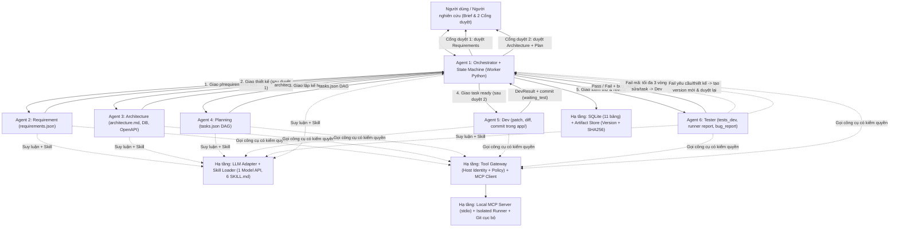

# BÁO CÁO NGHIÊN CỨU NỀN TẢNG CÔNG VIỆC R01

> **Mã công việc**: `R01` ([GitHub Issue #3](https://github.com/DaoNgocDinh/ChuyenDeKTPM/issues/3), thuộc kế hoạch tổng [#1](https://github.com/DaoNgocDinh/ChuyenDeKTPM/issues/1); tiền nhiệm: [`P01` (#2)](https://github.com/DaoNgocDinh/ChuyenDeKTPM/issues/2))  
> **Loại công việc**: Tìm hiểu · **Tuần tương đối**: Tuần 1  
> **Nhánh lưu trữ**: `R01` trên kho `DaoNgocDinh/ChuyenDeKTPM` (khởi tạo từ nền `main` commit `8c2fe71`)  
> **Ngày lập báo cáo**: 23/11/2026  
> **Trạng thái**: Đã hoàn thiện báo cáo `R01` trên nhánh riêng `R01` — **chờ chủ dự án rà soát và quyết định nghiệm thu** (chưa đóng Issue `#3`, chưa ghi vào danh sách đã hoàn thành của sổ cái `R10`)  
> **Nguồn chuẩn đối chiếu**: `Ke_hoach_nghien_cuu_he_thong_Multi_Agent.docx` (lập ngày 17/11/2026, 30 trang)  
> **SHA256 nguồn chuẩn**: `975228EA14EDCE90CFECBBFE05C9911DD33B35FD1A4ACEF75577A9499D884C9F`  
> **Mục tham chiếu**: Mục `2.1–2.3`, `2.9` (đối chiếu phạm vi với [`P01/de_cuong_P01.md`](https://github.com/DaoNgocDinh/ChuyenDeKTPM/blob/8c2fe7180ff08650b1488fe7d169ad9430427b73/P01/de_cuong_P01.md) và bản bàn giao [`#issuecomment-7104514172`](https://github.com/DaoNgocDinh/ChuyenDeKTPM/issues/3#issuecomment-7104514172))  
> **Ranh giới báo cáo**: Tài liệu này tổng hợp nền tảng lý thuyết, bảng thuật ngữ, mô hình 6 vai trò, 12 nhóm luồng hoạt động dự kiến và ví dụ minh họa của riêng công việc **`R01`**. Trong toàn bộ báo cáo, **kiến thức từ nguồn gốc** được tách bạch rõ với **quyết định thiết kế của kế hoạch đề tài** và **ví dụ minh họa khái niệm**. Tài liệu **không** thay thế báo cáo học thuật 7 phần (`B01`–`B06`), **không** hiện thực trước chi tiết đặc tả/hợp đồng (`D05`–`D11`) hay mã nguồn (`I01`–`I25`), và **không** chứa bằng chứng chạy thật hay kết luận thực nghiệm (`RQ1`–`RQ3` vẫn ở trạng thái chờ kiểm chứng).

---

## 1. Mục tiêu, phạm vi và nguồn đầu vào của `R01`

Công việc **`R01` — Học AI Agent, MAS, SDLC và thống nhất thuật ngữ** nhằm xây dựng nền tảng khái niệm vững chắc để người thực hiện **tự giải thích được cơ sở của kiến trúc đúng 6 vai trò logic** trước khi chuyển sang nghiên cứu sâu hơn về ReAct/workflow (`R02`), các nghiên cứu liên quan (`R03`–`R06`) và thiết kế hợp đồng kỹ thuật (`D05`–`D11`).

- **Điều kiện tiền nhiệm**: `P01` ([Issue #2](https://github.com/DaoNgocDinh/ChuyenDeKTPM/issues/2)) đã có đề cương chốt phạm vi MVP tại [`P01/de_cuong_P01.md`](https://github.com/DaoNgocDinh/ChuyenDeKTPM/blob/8c2fe7180ff08650b1488fe7d169ad9430427b73/P01/de_cuong_P01.md) (commit `8c2fe7180ff08650b1488fe7d169ad9430427b73`).
- **Dấu vết đầu vào của quá trình tự học và rà soát trên GitHub**:
  1. [Bình luận ghi chú đợt 1 (`#issuecomment-7102831272`, `2026-11-23T13:38:52Z`)](https://github.com/DaoNgocDinh/ChuyenDeKTPM/issues/3#issuecomment-7102831272): Ghi chú ban đầu của người thực hiện về LLM, SDLC, 6 Agent, sơ đồ tuyến tính khởi điểm và hai nguồn nhập môn (AWS LLM, Gimasys).
  2. [Bình luận ghi chú đợt 2 (`#issuecomment-7103979295`, `2026-11-23T14:25:35Z`)](https://github.com/DaoNgocDinh/ChuyenDeKTPM/issues/3#issuecomment-7103979295): Bổ sung định nghĩa Agent (nhấn mạnh không phải Agent nào cũng dùng LLM), 4 đặc tính Wooldridge–Jennings, lý do và mặt trái của MAS, định danh `Workflow-based Coordinated MAS`, ảnh sơ đồ đợt 1 và nguồn Anthropic, Wooldridge–Jennings.
  3. [Bình luận ghi chú đợt 3 (`#issuecomment-7104352917`, `2026-11-23T14:40:10Z`)](https://github.com/DaoNgocDinh/ChuyenDeKTPM/issues/3#issuecomment-7104352917): Chuẩn hóa định nghĩa MAS, chỉnh cách diễn đạt giảm quá tải ngữ cảnh và cập nhật ảnh sơ đồ đợt 2.
  4. [Bản tổng hợp bàn giao cho Anti (`#issuecomment-7104514172`, `2026-11-23T14:46:29Z`)](https://github.com/DaoNgocDinh/ChuyenDeKTPM/issues/3#issuecomment-7104514172) và [phiếu bàn giao tại `R10` (`#issuecomment-7104515223`, `2026-11-23T14:46:31Z`)](https://github.com/DaoNgocDinh/ChuyenDeKTPM/issues/12#issuecomment-7104515223): Tổng hợp khái niệm, bổ sung bảng SDLC đầu vào–đầu ra–rủi ro, bảng 18 thuật ngữ, 12 nhóm luồng hoạt động dự kiến và ví dụ xuyên suốt để lập báo cáo `R01`.

---

## 2. Kiến thức nền tảng rút ra: LLM, AI Agent và Multi-Agent System

Phần này phân tách rõ **khái niệm từ tài liệu gốc** với **quyết định áp dụng trong thiết kế đề tài**.

### 2.1. Mô hình ngôn ngữ lớn (LLM)

- **Theo nguồn kỹ thuật (AWS)**: Mô hình ngôn ngữ lớn (*Large Language Model — LLM*) là các mô hình học sâu kích thước lớn (thường dựa trên kiến trúc *transformer*) được tiền huấn luyện trên khối lượng dữ liệu khổng lồ, cho phép thực hiện nhiều tác vụ ngôn ngữ khác nhau trên cùng một mô hình như trả lời câu hỏi, tóm tắt tài liệu, dịch thuật, hoàn thành câu và sinh nội dung/mã nguồn từ câu lệnh ngôn ngữ tự nhiên ([AWS — What is a Large Language Model?](https://aws.amazon.com/vi/what-is/large-language-model/)).
- **Giới hạn nhận thức cần giữ trong đề tài**: Khả năng sinh văn bản hoặc mã nguồn trôi chảy **không tự chứng minh đầu ra đúng về mặt nghiệp vụ hay chạy đúng trong môi trường thực tế**. Mọi khẳng định "đã xong" hoặc "đã đúng" của LLM trong đề tài phải được kiểm chứng bằng schema, ràng buộc chương trình và kết quả thực thi thật.

### 2.2. AI Agent, 4 đặc tính Wooldridge–Jennings và ranh giới Model — Runtime

- **Định nghĩa từ nguồn gốc học thuật**: Theo Wooldridge & Jennings (1995), một tác tử (*agent*) theo nghĩa yếu (*weak notion of agency*) là một hệ thống máy tính (phần mềm hoặc phần cứng) hoạt động trong môi trường, cảm nhận môi trường và thực hiện hành động hướng tới mục tiêu, đặc trưng bởi 4 tính chất ([Wooldridge & Jennings, 1995 — Section 2.1](https://www.cs.ox.ac.uk/people/michael.wooldridge/pubs/ker95/subsubsectionstar3_1_1_1.html)):
  1. **Tự chủ (*Autonomy*)**: Có khả năng hoạt động mà không cần con người can thiệp vào từng thao tác nhỏ, đồng thời duy trì mức kiểm soát nhất định đối với hành động và trạng thái nội tại của chính mình.
  2. **Tương tác (*Social ability*)**: Có khả năng trao đổi, tương tác với các agent khác hoặc với con người (trong lý thuyết cổ điển thường mô tả qua một ngôn ngữ giao tiếp tác tử — *agent-communication language*).
  3. **Phản ứng (*Reactivity*)**: Nhận thức được môi trường xung quanh (thế giới vật lý, giao diện người dùng, hệ thống tệp, phản hồi công cụ...) và phản hồi kịp thời trước các thay đổi xảy ra trong môi trường đó.
  4. **Chủ động (*Pro-activeness*)**: Không chỉ phản ứng thụ động trước kích thích từ môi trường mà còn thể hiện hành vi hướng mục tiêu bằng cách chủ động khởi xướng hành động khi phù hợp.
- **Lưu ý phân biệt nguồn gốc với thiết kế đề tài**:
  - **Agent không bắt buộc phải sử dụng LLM**: Lý thuyết tác tử có từ trước kỷ nguyên LLM; LLM chỉ là một cách hiện thực bộ máy suy luận cho tác tử hiện đại.
  - **Cách hiện thực 4 đặc tính trong đề tài (quyết định thiết kế)**:
    - *Tự chủ có giới hạn*: Agent tự quyết định bước đọc tệp, tạo bản vá hay chạy kiểm tra trong phạm vi task, nhưng vẫn chịu ràng buộc bởi State Machine, quyền công cụ, trần ngân sách và 2 cổng duyệt của người dùng.
    - *Tương tác bằng artifact có cấu trúc*: Thay vì xây một ngôn ngữ giao tiếp agent cổ điển (như KQML/FIPA-ACL) hay để các agent trò chuyện văn bản tự do, đề tài chọn giao tiếp qua **envelope nội bộ + artifact JSON/Markdown có phiên bản và hash** do Host kiểm tra.
    - *Phản ứng & chủ động gắn với công cụ thật*: Phản ứng trước kết quả trả về từ MCP/runner (`exit_code`, log lỗi, `bug_report`), chủ động chọn tệp liên quan và đề xuất phương án sửa trong giới hạn quyền/quota được cấp.
- **Phân biệt AI Agent dựa trên LLM với một lời gọi LLM thông thường**:
  - **Một lời gọi LLM thông thường**: Nhận prompt đầu vào và trả về văn bản đầu ra trong một lượt; không có trạng thái phiên bền vững, không có vòng lặp gọi công cụ và không có cơ chế tự điều chỉnh từ phản hồi môi trường.
  - **AI Agent dựa trên LLM**: Kết hợp mô hình suy luận (LLM) với **mục tiêu & vai trò**, **trạng thái/ngữ cảnh**, **quy trình chuyên môn (skill)**, **tập công cụ được phép**, **vòng lặp hành động–quan sát–điều chỉnh** và **điều kiện dừng tường minh**. Ví dụ trong thiết kế đề tài: `Dev Agent` đọc đặc tả task, chọn tệp cần kiểm tra, đề xuất bản vá, gọi công cụ áp bản vá qua MCP, chạy kiểm tra phát triển và điều chỉnh mã dựa trên kết quả thực tế trả về.
- **Phân tách trách nhiệm giữa Model và Host/Runtime (kết hợp góc nhìn Anthropic)**:
  - Theo [Anthropic — Building effective agents (19/12/2024)](https://www.anthropic.com/research/building-effective-agents), cần phân biệt rõ **Workflow** (nơi LLM và công cụ được điều phối theo đường đi mã nguồn định sẵn) với **Agent** (nơi LLM tự chủ động điều hướng quy trình và việc sử dụng công cụ của mình trong một vòng lặp phản hồi). *(Chi tiết về ReAct và đối chiếu sâu Workflow vs Agent sẽ tiếp tục được nghiên cứu chuyên biệt tại `R02` [#4].)*
  - **Quyết định thiết kế trong đề tài**: LLM chỉ đóng vai trò **đề xuất nội dung hoặc đề xuất lời gọi công cụ**; toàn bộ việc kiểm tra schema, xác thực danh tính vai trò, cưỡng chế quyền truy cập, quản lý trạng thái, tính quota, thực thi tool/runner và lưu bằng chứng thuộc về **Host/Runtime bằng chương trình**. Model tuyệt đối không tự cấp quyền, không tự duyệt thay người dùng và không tự xác nhận hoàn thành nếu thiếu bằng chứng thực thi.

### 2.3. Multi-Agent System (MAS) và bản chất *Workflow-based Coordinated MAS*

- **Định nghĩa MAS**: Multi-Agent System (hệ thống đa tác tử) là hệ thống gồm nhiều agent tương tác và phối hợp với nhau nhằm giải quyết mục tiêu chung hoặc các mục tiêu có liên hệ mà một thực thể đơn lẻ khó đảm nhiệm gọn gàng.
- **Định vị kiến trúc của đề tài — *Workflow-based Coordinated MAS***:
  - **Không phải "6 lần gọi LLM nối tiếp" (Prompt Chaining thuần túy)**: Hệ thống không chạy một chiều sinh văn bản qua 6 prompt. Mỗi vai trò bị phân tách quyền cứng tại `Tool Gateway`, tương tác công cụ thật qua MCP (`workspace`, `git`, `runner`), giao tiếp qua artifact JSON bất biến có phiên bản/hash, và có vòng lặp phản hồi có điều kiện (`Tester → Orchestrator → Dev`, hoặc quay ngược về `Requirement`/`Architecture` khi lỗi nằm ở đầu nguồn).
  - **Không phải "Autonomous Swarm" (Bầy đàn tự trị phi tập trung)**: Các agent không tự lập nhóm, không tự sinh thêm vai trò thứ 7, không tự thương lượng gọi chéo nhau hỗn loạn và không chạy vô hạn. Thứ tự các giai đoạn vĩ mô bị khóa cứng bởi **State Machine** qua trung tâm **`Agent 1: Orchestrator`**, có 2 cổng duyệt con người và trần ngân sách/vòng sửa cứng để bảo đảm kỷ luật kỹ nghệ phần mềm và khả năng tái lập thực nghiệm.
  - **Ranh giới triển khai MVP**: Cả 6 vai trò logic có thể dùng **chung một LLM API** nhưng tách biệt hoàn toàn về ngữ cảnh đầu vào, skill nạp vào, schema đầu ra và ma trận quyền. Do MVP dùng **1 worker thực thi tuần tự**, việc có 6 vai trò **không** đồng nghĩa với 6 model riêng, 6 tiến trình song song hay lợi thế xử lý đồng thời.
- **Lý do nghiên cứu phân vai và mặt trái cần đánh đổi**:

| Khía cạnh | Kỳ vọng nghiên cứu (Giả thuyết cần kiểm chứng) | Mặt trái / Đánh đổi cần kiểm soát |
|---|---|---|
| **Ngữ cảnh & chuyên môn hóa** | Giảm quá tải ngữ cảnh (*context overload*) khi không phải nhồi toàn bộ quy trình vào một prompt duy nhất | Tốn thêm token và độ trễ điều phối do phải nạp lại ngữ cảnh/artifact qua từng bước bàn giao |
| **Quyền hạn & an toàn** | Phân tách quyền rõ ràng theo nguyên tắc tối thiểu (`Dev` chỉ ghi `app`, `Tester` chỉ ghi `tests_dev`, không ai chạm `evaluation/`) | Phát sinh lỗi phân quyền hoặc thiếu ngữ cảnh nếu hợp đồng bàn giao thiết kế chưa chặt |
| **Chất lượng & kiểm chứng** | Tách người tạo mã với người review/kiểm thử giúp kiểm tra chéo và khoanh vùng lỗi theo giai đoạn | Rủi ro lỗi bàn giao (schema sai, thiếu trường) và **lan truyền lỗi** từ yêu cầu/thiết kế sang mã và test |
| **Hiệu quả tổng thể (`RQ1`)** | Có thể cải thiện mức đáp ứng yêu cầu trên bài toán CRUD nhỏ | **Không có bảo đảm MAS luôn tốt hơn Single-Agent** khi chia chung cùng trần ngân sách tổng — cần đo bằng thực nghiệm đối chứng `S` vs `M` ở `E05` |

---

## 3. Tổng quan SDLC: Đầu vào, Đầu ra, Rủi ro lan truyền và Ánh xạ MVP

Vòng đời phát triển phần mềm (*Software Development Life Cycle — SDLC*) là quy trình có cấu trúc giúp các nhóm phát triển lập kế hoạch, phân tích, thiết kế, xây dựng, kiểm thử, triển khai và bảo trì phần mềm hiệu quả về chất lượng, chi phí và thời gian ([AWS — What is SDLC?](https://aws.amazon.com/what-is/sdlc/)). Trong thực tế, cách chia hoặc gộp các pha có thể khác nhau tùy tài liệu; các pha cũng thường lặp và có phản hồi thay vì chỉ đi một lượt thẳng.

### 3.1. Bảng các pha SDLC và rủi ro sai sót lan truyền

*(Lưu ý nguồn: Các cột đầu vào, đầu ra cần kiểm tra và rủi ro dưới đây là **bảng ánh xạ phục vụ phân tích của kế hoạch đề tài**, tổng hợp từ bản bàn giao `#issuecomment-7104514172` và kế hoạch Word gốc, không phải bảng trích nguyên văn từ AWS hay Gimasys.)*

| Pha SDLC | Đầu vào chính | Đầu ra cần kiểm tra | Rủi ro nếu sai hoặc thiếu (hiệu ứng lan truyền) |
|---|---|---|---|
| **1. Lập kế hoạch dự án** | Bài toán/vấn đề, mục tiêu, nguồn lực, ràng buộc | Phạm vi dự án, tiến độ, ngân sách, kế hoạch rủi ro | Phạm vi phình quá lớn, thiếu thời gian/chi phí để xây dựng và kiểm chứng đầy đủ |
| **2. Phân tích yêu cầu** | Mô tả bài toán (*brief*), ràng buộc, câu trả lời làm rõ | Tài liệu yêu cầu (SRS), tác nhân, FR/NFR, giả định, tiêu chí chấp nhận | Hiểu sai hoặc bỏ sót yêu cầu sẽ **lan truyền xuyên suốt** sang thiết kế, danh sách task, mã nguồn và cả test |
| **3. Thiết kế** | Yêu cầu đã được duyệt | Kiến trúc hệ thống, ADR, lược đồ CSDL (DB schema), hợp đồng API, bố cục UI, chiến lược kiểm thử | API và DB không nhất quán, thiếu thành phần xử lý cho một số FR, khiến Dev triển khai lệch hợp đồng |
| **4. Lập trình** | Danh sách task, yêu cầu/thiết kế đúng phiên bản, mã hiện tại | Bản vá (*patch*), mã nguồn, diff, tệp khóa phụ thuộc (*lockfile*), kết quả tự kiểm tra | Lỗi logic/validation, vi phạm hợp đồng API, sửa nhầm vùng tệp hoặc ghi đè mã cũ (*stale overwrite*) |
| **5. Kiểm thử** | Tiêu chí chấp nhận, thiết kế, mã nguồn tại commit xác định | Ca kiểm thử (*test cases*), báo cáo chạy test thật (*runner report*), kết quả review, báo cáo lỗi (*bug report*) và kết quả kiểm thử lại (*retest*) | Test thiếu hoặc viết sai gây bỏ lọt lỗi; nếu hệ thống tự sinh test và tự chấm dễ tạo thiên lệch dương giả |
| **6. Triển khai** | Bản build đã qua kiểm tra, cấu hình môi trường | Gói cài đặt/chạy, tệp cấu hình, hướng dẫn vận hành và báo cáo *smoke test* | Lệch môi trường chạy, thiếu dependency, cấu hình sai hoặc làm rò rỉ khóa bí mật (*secret*) |
| **7. Bảo trì** | Phản hồi người dùng, báo cáo lỗi, log vận hành và thay đổi yêu cầu | Bản sửa có phiên bản, báo cáo kiểm thử hồi quy (*regression*), tài liệu cập nhật | Sửa lỗi mới làm hỏng chức năng cũ (*regression*), hoặc tài liệu không còn đồng bộ với mã nguồn |

### 3.2. Các mô hình SDLC phổ biến và phạm vi tự động hóa của MVP

- **Các mô hình tổ chức SDLC đã tìm hiểu**:
  - **Waterfall**: Triển khai các pha tuần tự từ trên xuống; ranh giới pha và tài liệu đầu ra rõ nhưng kém linh hoạt khi yêu cầu thay đổi muộn.
  - **Iterative**: Phát triển và cải tiến hệ thống lặp lại qua nhiều chu kỳ, phát hiện sớm sai lệch thiết kế.
  - **Spiral**: Kết hợp vòng lặp tăng trưởng với phân tích rủi ro có hệ thống ở từng chu kỳ.
  - **Agile**: Chia nhỏ thành các chu kỳ phát triển ngắn, liên tục lấy phản hồi và thích ứng thay đổi.
- **Ranh giới áp dụng vào đề tài MVP**:
  - Không suy diễn rằng đề tài phải tự động hóa toàn bộ SDLC. Phiên bản MVP tập trung tự động hóa có kiểm soát đoạn lõi: **Phân tích yêu cầu → Thiết kế → Lập kế hoạch task kỹ thuật → Lập trình → Kiểm thử & sửa lỗi có giới hạn → Đóng gói đầu ra cục bộ**.
  - Các hoạt động **tự triển khai lên môi trường production**, tự `push`/`merge` kho mã từ xa, CI/CD hay vận hành bảo trì dài hạn nằm **ngoài phạm vi MVP** (`F04`).
- **Phân biệt hai loại "kế hoạch" để tránh nhầm thứ tự**:
  - **Lập kế hoạch dự án (đầu SDLC)**: Chốt mục tiêu, phạm vi, ngân sách, mốc thời gian của cả dự án (tương ứng công việc quản lý `P01`).
  - **Planning Agent trong sản phẩm 6-Agent**: Chuyển *yêu cầu đã duyệt* và *thiết kế kiến trúc đã có* thành đồ thị công việc kỹ thuật có phụ thuộc (`tasks.json` dạng DAG) cho `Dev` và `Tester`. Vì cần biết trước thành phần, CSDL và API mới chia được task kỹ thuật rõ ràng, việc đặt **`Planning Agent` đứng sau `Architecture Agent`** là nhất quán với thiết kế đề tài.

---

## 4. Bảng thuật ngữ thống nhất và ranh giới thành phần

*(Lưu ý nguồn: Phần khái niệm cốt lõi về LLM/Agent/MAS đối chiếu từ AWS, Wooldridge–Jennings và Anthropic; phần ánh xạ `MCP`, `Tool Gateway`, `Runner`, `Skill`, `Worker`, `State machine`, `Artifact`, `Checkpoint` là **quy ước thiết kế của kế hoạch đề tài**, không quy toàn bộ cho Wooldridge–Jennings.)*

| # | Thuật ngữ | Cách hiểu thống nhất trong đề tài | Ranh giới / Phân biệt bắt buộc giữ |
|---|---|---|---|
| 1 | **LLM** | Mô hình ngôn ngữ lớn xử lý/sinh nội dung, hỗ trợ suy luận và đề xuất hành động | Một lời gọi LLM đơn lẻ chưa đủ tạo thành AI Agent |
| 2 | **Agent sản phẩm** | Một trong **đúng 6 vai trò logic** được hiện thực bên trong nguyên mẫu | Có hợp đồng đầu vào/đầu ra, ngữ cảnh, skill, quyền, trạng thái và điều kiện dừng riêng |
| 3 | **Agent hỗ trợ** | Công cụ AI bên ngoài hỗ trợ người nghiên cứu đọc nguồn, tổng hợp, viết hoặc kiểm tra (ví dụ: trợ lý bàn giao, Anti) | **Không** được tính là "Agent sản phẩm thứ 7" |
| 4 | **Orchestrator Agent** | Vai trò điều phối (`Agent 1`): giao việc, theo dõi tiến độ, phân loại phản hồi lỗi và tổng hợp kết quả | Không tự duyệt thay người dùng, không tự sửa mã nguồn; mọi bước chuyển bị State Machine kiểm soát |
| 5 | **Worker** | Tiến trình nền nhận job từ hàng đợi bền (SQLite) và thực thi workflow tuần tự | Là **thành phần hạ tầng**, không phải agent; dùng 1 worker không tự bảo đảm chống chạy trùng nếu thiếu lease/transaction ngắn |
| 6 | **State machine** | Máy trạng thái bằng chương trình quy định trạng thái hợp lệ và điều kiện chuyển bước (*transition guards*) | Chặn nhảy bước, duyệt thiếu hoặc vượt quota kể cả khi model đề xuất khác |
| 7 | **MCP host / client / server** | Kiến trúc giao thức kết nối công cụ: Host quản lý ngữ cảnh/quyền; Client gửi yêu cầu; Local Server (`stdio`) cung cấp công cụ | MCP chuẩn hóa giao diện công cụ, **không** tự điều phối 6 agent và **không** tự tạo sandbox cô lập |
| 8 | **Tool Gateway** | Lớp trung gian kiểm tra danh tính tin cậy (`role`, `run_id`, `step_id`) và chính sách quyền trước khi cho gọi MCP | Tuyệt đối không tin vai trò do model tự khai báo trong tham số lời gọi |
| 9 | **Tool** | Hành động có lược đồ tham số rõ ràng (ví dụ: đọc tệp, áp bản vá, chạy bộ test theo allowlist) | Chỉ thực thi trong phạm vi quyền và giới hạn tài nguyên đã cấu hình |
| 10 | **Runner** | Môi trường cô lập chạy lệnh build, smoke và test, trả về `exit_code`, số ca pass/fail và log | Cô lập mã sinh, không chứa LLM API key, không nhận shell tùy ý; là hạ tầng, **không phải `Tester Agent`** |
| 11 | **Skill** | Gói tri thức/quy trình chuyên môn đóng gói theo thư mục chứa `SKILL.md` (và tài nguyên tùy chọn) | Là hướng dẫn nạp vào ngữ cảnh; **không** phải agent mới, **không** phải fine-tuning và **không** tự cấp quyền công cụ |
| 12 | **Artifact** | Sản phẩm bàn giao có cấu trúc, bất biến, gắn `ID`, `version`, `schema_version`, `SHA256` và `parent_refs` | Ví dụ `requirements.json`, `architecture.md`, `tasks.json`, `test_report`; luôn giữ phiên bản cũ để truy vết |
| 13 | **Run** | Một lượt chạy hoàn chỉnh từ đầu vào cố định đến trạng thái kết thúc | Tính cả các lần chạy `failed`, `cancelled` hoặc `needs_human_review` |
| 14 | **Task** | Đơn vị công việc kỹ thuật nhỏ trong kế hoạch, gắn `requirement_ids`, `dependency_ids` và `done_conditions` | Không chuyển sang `done` chỉ vì `Dev` tuyên bố đã viết mã xong |
| 15 | **Test case** | Một kịch bản kiểm thử cụ thể gồm đầu vào, thao tác và kết quả mong đợi | Là dữ liệu/đầu ra kiểm thử; vai trò thứ 6 phải gọi chính xác là **`Tester Agent`**, không gọi là "Test case" |
| 16 | **Test phát triển (`tests_dev`)** | Bộ kiểm thử do `Dev`/`Tester` xây và chạy trong quá trình phát triển và sửa lỗi | Tách biệt hoàn toàn với bộ **test nghiệm thu độc lập (`evaluation/`)** do người nghiên cứu quản lý |
| 17 | **Acceptance criteria** | Tiêu chí chấp nhận hành vi được khóa làm chuẩn đánh giá mức đáp ứng yêu cầu | Agent được đọc tiêu chí để triển khai, nhưng bị cấm tự sửa tiêu chí/bộ test nghiệm thu để lấy pass |
| 18 | **Checkpoint / `operation_id`** | Dữ liệu lưu dấu bước đã thực thi và mã định danh thao tác công cụ | Dùng để đối chiếu an toàn khi `resume`; không giả định mọi tool đều có thể chạy lại mù quáng (*idempotent*) |

---

## 5. Mô hình 6 vai trò logic và sơ đồ phối hợp

### 5.1. Đặc tả tóm tắt 6 vai trò logic (khớp thiết kế kế hoạch & `P01`)

| # | Vai trò logic | Đầu vào chính | Đầu ra / Bàn giao chính | Ranh giới & điều cấm tuyệt đối |
|---|---|---|---|---|
| **1** | **Orchestrator Agent** | Brief, trạng thái run/checkpoint, artifact đã duyệt, kết quả agent/tool | Lệnh giao task, đề xuất phân loại lỗi, yêu cầu duyệt, tổng hợp kết quả run | Không tự viết/sửa mã; không tự duyệt thay người dùng; bị ràng buộc bởi State Machine |
| **2** | **Requirement Agent** | Brief, ràng buộc, câu trả lời làm rõ của người dùng, bản yêu cầu trước (nếu sửa) | Danh sách tác nhân/use case, FR/NFR, giả định, câu hỏi mở, acceptance criteria (`requirements.json` + bản Markdown duyệt) | Không sửa bản đã duyệt; không tự thêm tính năng ngoài phạm vi (đăng nhập, thanh toán…); không sửa mã |
| **3** | **Architecture Agent** | `requirements` đúng phiên bản đã duyệt, ràng buộc stack cố định | `architecture.md`, ADR, sơ đồ thành phần, entities/quan hệ DB, OpenAPI, bố cục UI và chiến lược kiểm thử | Không tự đổi stack/framework đã khóa; không bỏ qua FR bất khả thi (phải trả blocker); không sửa DB nền tảng |
| **4** | **Planning Agent** | `requirements` đã duyệt + `architecture` đúng phiên bản | `tasks.json` dạng DAG không chu trình (`task_id`, `requirement_ids`, `dependency_ids`, tệp dự kiến, `done_conditions`, test cần chạy) | Không tự sửa yêu cầu đã duyệt; không trộn lập kế hoạch với viết mã; không bỏ sót FR |
| **5** | **Dev Agent** | Task ở trạng thái `ready`, hợp đồng yêu cầu/thiết kế đúng phiên bản, mã hiện tại, skill và `bug_report` (nếu sửa) | Patch/diff gắn `task_id` & `input_commit`/`expected_hash`, commit checkpoint, `dependency lock`, `DevResult` và kết quả tự kiểm tra | Chỉ ghi trong vùng `app` thuộc đúng run; không tự nghiệm thu cuối; không sửa `evaluation/`, `skills/`, prompt, policy hay mã nền tảng |
| **6** | **Tester Agent** | FR & acceptance criteria, thiết kế, task, diff và mã nguồn tại commit cụ thể | Ca kiểm thử trong `tests_dev`, kết quả review (`review_report.json`), kết quả runner thật, `bug_report.json` và kết quả retest | Không sửa mã ứng dụng (`app`); không sửa bộ test nghiệm thu độc lập (`evaluation/`); không tách thêm `Reviewer Agent` |

### 5.2. Sơ đồ kiến trúc vai trò và luồng điều phối

- **Ghi nhận tiến trình chuẩn hóa sơ đồ trong `R01`**: Ở bình luận đầu tiên (`#issuecomment-7102831272`), sơ đồ sơ khai viết theo dạng chuỗi `Agent1 -> Agent 2, Agent 3 -> Agent 4 -> Agent 5 -> Agent 6`. Qua các lần rà soát (`#issuecomment-7103979295`, `#issuecomment-7104352917`, `#issuecomment-7104514172`), sơ đồ đã được chuẩn hóa để phản ánh đúng 4 nguyên tắc cốt lõi của kế hoạch: (1) `Agent 1: Orchestrator` là trung tâm điều phối gắn với State Machine chứ không chỉ là nút đầu chuỗi; (2) `Requirement` đi trước `Architecture` và bị chắn bởi **Cổng duyệt 1**, sau `Architecture` + `Planning` là **Cổng duyệt 2**; (3) có vòng phản hồi `Tester → Orchestrator → Dev` (≤ 3 vòng sửa/task) và nhánh định tuyến lỗi về `Requirement`/`Architecture`; (4) tách bạch 6 vai trò logic khỏi tầng hạ tầng (`LLM Adapter`, `Skill Loader`, `Tool Gateway`, `MCP Client/Server`, `Runner`, `SQLite/Artifact Store`).

---

## 6. Đầy đủ 12 nhóm luồng hoạt động dự kiến trong phạm vi MVP

> **Lưu ý ranh giới thiết kế**: Toàn bộ 12 nhóm luồng dưới đây là **thiết kế vận hành dự kiến ở mức khái niệm của kế hoạch đề tài** (tổng hợp từ bản Word gốc và bàn giao `#issuecomment-7104514172`), dùng làm cơ sở thống nhất trước khi đặc tả chi tiết JSON/Pydantic schema, bảng chuyển trạng thái chính thức, API và chính sách tại **`D05`–`D11`** (Tuần 3). Đây **không phải** báo cáo về mã nguồn đã chạy thật.

### 6.1. Luồng chung bên trong mỗi bước agent
1. Worker đọc checkpoint bền và xác định bước chuyển hợp lệ; `Orchestrator` giao đúng vai trò logic, còn Host gắn ngữ cảnh tin cậy (`project_id`, `run_id`, `step_id`, `role`).
2. Hệ thống nạp đúng phiên bản/hash các artifact đầu vào, prompt vai trò và `SKILL.md` tương ứng; kiểm tra quyền, trạng thái và hạn mức quota trước khi thực thi.
3. Model diễn giải nhiệm vụ để tạo đầu ra hoặc đề xuất lời gọi công cụ. Nếu cần công cụ: `Tool Gateway` kiểm tra chính sách → `MCP Client` chuyển sang local MCP server (`stdio`) → công cụ/runner thực thi và trả kết quả có cấu trúc.
4. Agent tiếp nhận phản hồi thật từ công cụ để quyết định bước kế tiếp trong phạm vi cho phép; tuyệt đối không coi câu trả lời tự nhận *"đã chạy test"* của model là báo cáo thực thi.
5. Khi có đầu ra, chương trình kiểm tra hợp lệ về cả cú pháp (JSON/Pydantic schema) lẫn ngữ nghĩa (tính duy nhất của ID, tham chiếu FR, đồ thị DAG không chu trình, commit hash, bằng chứng runner). Nếu sai, trả thông báo lỗi cụ thể về đúng agent để tự sửa trong số lần hữu hạn.
6. Đầu ra hợp lệ được lưu thành artifact bất biến kèm `version`, `SHA256`, `parent_refs`; ghi đầy đủ `agent_steps`, `events`, `tool_calls` và `usage`. Sau đó `Orchestrator` mới xét bàn giao bước tiếp theo.
7. Nếu thiếu đầu vào, cần con người quyết định hoặc chạm ngưỡng giới hạn, hệ thống dừng đúng nhánh tương ứng; cấm tự chèn dữ liệu giả để vượt kiểm tra.

### 6.2. Luồng chính: từ brief đầu vào đến đóng gói kết quả
1. **Tạo dự án và yêu cầu chạy**: Người dùng nhập brief, ràng buộc và cấu hình; API lưu dữ liệu và tạo job vào hàng đợi bền với `idempotency_key`, trả `202 Accepted` kèm `run_id` (trạng thái `queued`).
2. **Nhận job tuần tự**: Một worker duy nhất nhận job theo cơ chế `worker_lease`, chuyển run sang `running`. Chỉ một run hoạt động tại một thời điểm; job đến sau chờ ở `queued`, không dùng chung vùng ghi workspace.
3. **Phân tích yêu cầu (`Requirement`)**: Tạo tác nhân, FR, NFR, giả định, câu hỏi mở và tiêu chí chấp nhận; lưu `requirements` phiên bản mới. Nếu có câu hỏi chặn, rẽ sang nhánh `6.3`.
4. **Cổng duyệt 1**: Run chuyển `waiting_approval` chờ duyệt `requirements`. Chỉ khi người dùng duyệt đúng `artifact_id`/`version`/`hash` mới mở bước `Architecture`; nếu yêu cầu chỉnh sửa, rẽ sang nhánh `6.4`.
5. **Thiết kế (`Architecture`)**: Đọc `requirements` đã duyệt để tạo thiết kế, ADR, DB schema, hợp đồng OpenAPI, bố cục giao diện và ánh xạ FR. Nếu đầu ra không hợp lệ hoặc yêu cầu bất khả thi thì rẽ nhánh xử lý thích hợp, không âm thầm bỏ qua.
6. **Lập kế hoạch (`Planning`)**: Đọc `requirements` và `architecture` đúng phiên bản, chia nhỏ thành danh sách task phụ thuộc (`tasks.json`). Kiểm tra không có chu trình, không thiếu phụ thuộc, không bỏ sót FR và mỗi task đều có `done_conditions` cùng test cần chạy.
7. **Cổng duyệt 2**: Người dùng đọc và duyệt gộp **cả `architecture` lẫn `plan` đúng phiên bản**. `Dev` tuyệt đối chưa được thực thi trước khi qua cổng này.
8. **Chọn task khả dụng**: Task ở `todo` chỉ chuyển sang `ready` khi mọi task phụ thuộc đã hoàn tất, đầu vào hợp lệ và các phê duyệt liên quan còn hiệu lực. Nếu còn task chưa xong nhưng không có task nào `ready`, xác định blocker thay vì coi là hoàn thành.
9. **Triển khai (`Dev`)**: Chuyển task `ready → in_progress`; đọc ngữ cảnh/mã, áp dụng bản vá qua MCP có gắn `input_commit` và `expected_hash`, chạy tự kiểm tra phát triển theo runner profile, lưu diff/commit/`DevResult`, chuyển task sang `waiting_test`.
10. **Kiểm thử & Review (`Tester`)**: Review thay đổi, viết test phát triển (`tests_dev`), chạy runner thật và đối chiếu báo cáo gắn đúng commit. Nếu fail thì rẽ sang nhánh `6.5` hoặc `6.7`; nếu pass đủ điều kiện hoàn tất của task, `Orchestrator` mới chuyển task sang `done`.
11. **Tiếp tục đồ thị DAG**: Mở khóa các task kế tiếp trong DAG và lặp các bước 8–10, duy trì liên kết truy vết `FR → task → patch → test/bug`.
12. **Kiểm tra tích hợp & đánh giá cuối**: Khi các task hoàn tất, thực thi build, smoke test và đánh giá theo bộ tiêu chí nghiệm thu độc lập (theo quy trình đánh giá đã chốt). Các bài test phát triển ở mức task pass chưa tự đồng nghĩa toàn bộ ứng dụng đạt chuẩn.
13. **Đóng gói & bàn giao**: Tổng hợp artifact đã duyệt, mã nguồn, lockfile, README, log/report/manifest và gói export đã lọc secret để người dùng xem và quyết định chấp nhận. Nếu người dùng yêu cầu sửa, phân loại rõ là sửa lỗi task hay thay đổi phạm vi. Run chỉ chuyển `completed` khi đáp ứng đầy đủ điều kiện hoàn tất đã chốt.

### 6.3. Luồng thiếu hoặc mâu thuẫn yêu cầu
- Khi `Requirement` phát hiện điểm mơ hồ hoặc mâu thuẫn ảnh hưởng hành vi nghiệp vụ, agent ghi rõ câu hỏi mở, giả định và phần bị chặn; `Orchestrator` chuyển câu hỏi tới người dùng và tạm dừng trước Cổng duyệt 1.
- Sau khi người dùng trả lời, hệ thống lưu câu trả lời, tạo `requirements` phiên bản mới, kiểm tra lại rồi mới trình duyệt.
- Không tự ý suy đoán các quyết định làm thay đổi hành vi nghiệp vụ. Lưu ý: `needs_clarification` là tình trạng nghiệp vụ của bước/artifact; cách ánh xạ chính thức vào trạng thái chờ của run sẽ được chốt tại **`D08`**, không tự thêm enum trạng thái run mới trong ghi chú `R01`.

### 6.4. Luồng duyệt, yêu cầu chỉnh sửa và xung đột phiên bản
- **Chấp nhận duyệt**: Ghi nhận người duyệt, quyết định, nhận xét, `artifact_id`, `version`/`hash` và thời điểm; chỉ mở bước kế tiếp cho đúng phiên bản đã duyệt.
- **Yêu cầu sửa `requirements`**: Quay lại `Requirement`, giữ nguyên phiên bản cũ, sinh phiên bản mới và trình duyệt lại.
- **Yêu cầu sửa `architecture`/`plan`**: Định tuyến về `Architecture` hoặc `Planning`; nếu thiết kế thay đổi thì rà soát các task phụ thuộc và trình duyệt lại trọn bộ `architecture + plan` tương ứng.
- **Xung đột phiên bản (*stale approval*) hoặc sai run**: Từ chối bằng mã lỗi rõ ràng (`approval_version_conflict`) và hiển thị phiên bản mới nhất để đọc/duyệt lại; không tái sử dụng phê duyệt cũ cho phiên bản mới.
- **Chưa có quyết định duyệt**: Giữ nguyên trạng thái `waiting_approval`; tuyệt đối không tự duyệt theo hết giờ (*timeout*) hoặc theo đề xuất của model.

### 6.5. Luồng lỗi mã nguồn và vòng sửa–kiểm tra lại (`Tester ↔ Dev`)
- `Tester` chạy suite trên runner thật → phát hiện fail thật → tạo `bug_report.json` chứa mức độ nghiêm trọng, `FR`/`task`, bước tái hiện, `expected`/`actual`, đường dẫn report/log và `commit` tương ứng → `Orchestrator` xác nhận phân loại lỗi mã → chuyển task sang `rework` → `Dev` nhận bug cùng hợp đồng thiết kế → áp dụng bản vá mới → tự kiểm tra → chuyển `waiting_test` → `Tester` chạy lại **cả ca lỗi lẫn kiểm thử hồi quy (*regression*)**.
- Nếu đạt: ghi nhận bug đã khắc phục, liên kết patch/report đúng commit và xét điều kiện chuyển `done`.
- Nếu còn lỗi: lưu đủ bằng chứng của vòng hiện tại và tiếp tục nếu còn quota.
- **Giới hạn cứng**: Tối đa **3 vòng sửa sau lần triển khai đầu của mỗi task**. Vẫn lỗi sau vòng 3 thì task chuyển `blocked` và run chuyển `needs_human_review`; cấm tạo task hoặc run mới chỉ để né giới hạn.
- **Giữ nguyên ranh giới quyền**: `Tester` không tự sửa mã `app`; `Dev` không sửa test nghiệm thu để lấy pass. Nếu xác minh lỗi nằm ở test phát triển viết sai, `Tester` sửa test trong `tests_dev` kèm giải thích/bằng chứng rồi chạy lại, tuyệt đối không sửa tiêu chí chấp nhận đã khóa.

### 6.6. Luồng lỗi hoặc thay đổi yêu cầu / thiết kế
- Khi phát hiện mâu thuẫn nghiệp vụ, thiếu FR hoặc hợp đồng thiết kế không thể đáp ứng ở khâu lập trình/kiểm thử, `Orchestrator` trả việc về đúng `Requirement` hoặc `Architecture` thay vì vá âm thầm trong mã nguồn.
- Tạo phiên bản artifact mới, xác định các artifact/task/patch/test chịu ảnh hưởng, đánh dấu cần xem lại, cập nhật thiết kế/kế hoạch liên quan và yêu cầu người dùng duyệt lại trước khi mở lại task.
- Mọi lịch sử phiên bản cũ đều được giữ nguyên. Trong phạm vi đã duyệt, lỗi kỹ thuật được tự động sửa trong hạn mức; thay đổi hành vi hoặc phạm vi bắt buộc có quyết định con người. Sau mốc khóa thực nghiệm (Tuần 9), mọi thay đổi phải tăng phiên bản và chạy lại đồng đều theo protocol.

### 6.7. Luồng đầu ra sai, lỗi LLM/tool/runner và vi phạm quyền

| Tình huống ngoại lệ | Cơ chế xử lý dự kiến trong kế hoạch |
|---|---|
| JSON/schema, ID, tham chiếu FR hoặc DAG không hợp lệ | Trả chi tiết lỗi xác thực về đúng agent để sửa lại trong số lần giới hạn; chưa hợp lệ thì không bàn giao |
| LLM timeout, API gián đoạn, mất kết nối MCP | Ghi loại lỗi, số lần thử (*attempt*), usage (nếu có); thử lại theo cấu hình và quota, không lặp vô hạn |
| Gọi tool sai quyền, *path traversal*, giả mạo role/run, ghi vùng cấm | Chặn ngay tại `Tool Gateway`/server, ghi log kiểm toán đã che secret; không mở rộng quyền hay chuyển sang shell để lách |
| Runner thiếu dependency hoặc lỗi môi trường hạ tầng | Phân biệt rõ với lỗi mã nguồn; lưu report/log, xử lý qua runner profile hợp lệ hoặc đưa về `needs_human_review` |
| Thao tác có tác dụng phụ không rõ đã hoàn tất hay chưa | Chuyển `pending_recovery` để đối chiếu `operation_id`, `patch_hash` và commit trước khi quyết định thử lại |
| Lỗi không thể khôi phục | Lưu checkpoint và lý do dừng; chuyển `failed` theo chính sách hoặc `needs_human_review` nếu cần con người quyết định |

- Mọi phân loại lỗi phải kèm bằng chứng thật. Không coi kết quả `error`, `skip`, `0 tests` hoặc `chưa chạy` là `pass`; không tự xóa trường hoặc bịa dữ liệu để ép đầu ra hợp schema.

### 6.8. Luồng hết ngân sách, thời gian hoặc giới hạn vòng lặp
- Host cộng dồn tổng token của **toàn bộ 6 vai trò và mọi lượt retry**, tổng số lần gọi công cụ, tổng thời gian thực thi và số vòng sửa; kiểm tra trước và sau mỗi thao tác.
- Sáu vai trò **chia chung một trần ngân sách tổng toàn run** (không nhân sáu). Khi chạm giới hạn, hệ thống không cấp thao tác mới, dừng/hủy tiến trình đang chạy theo chính sách, ghi usage, checkpoint và lý do, đồng thời chuyển `needs_human_review` khi cần con người xử lý.
- Nếu nhà cung cấp LLM không trả về usage thì đánh dấu thiếu usage, **không** mặc định bằng 0. Mọi quyết định tăng quota hoặc chạy tiếp phải có xác nhận ghi nhận lại; trong thực nghiệm chính phải tuân thủ cùng một protocol cho cả cấu hình `S` và `M`.

### 6.9. Luồng hủy run (`cancel`)
- Khi người dùng gửi lệnh hủy từ trạng thái cho phép, backend ghi nhận yêu cầu; worker ngừng giao bước mới, hủy toàn bộ cây tiến trình con (runner, tiến trình MCP con thuộc run), giải phóng tài nguyên, ghi checkpoint cuối và chuyển run sang `cancelled`.
- Giữ lại toàn bộ artifact và log đã sinh trước đó để truy vết; không đánh dấu `completed`. Run đã đóng ở trạng thái kết thúc không bị thay đổi trạng thái tùy tiện; quy tắc tạo run mới hoặc khôi phục chi tiết được chốt ở `D08`.

### 6.10. Luồng khởi động lại và khôi phục (`restart` & `resume`)
- Sau khi worker hoặc API bị gián đoạn và khởi động lại, hệ thống đọc `job`, `worker_lease`, `checkpoint`, `agent_steps` và `events` đã lưu, rồi đối chiếu phiên bản đầu vào, trạng thái duyệt, `operation_id`, `patch_hash` và `commit`:
  - **Bước đã chắc chắn hoàn tất**: tái sử dụng artifact đã xác minh, không chạy lại thừa.
  - **Bước chưa thực hiện và an toàn**: tiếp tục từ bước hợp lệ tiếp theo.
  - **Thao tác công cụ có tác dụng phụ chưa rõ kết quả**: chuyển `pending_recovery` để kiểm chứng thực tế hoặc yêu cầu người dùng xử lý trước khi tiếp tục.
  - **Đầu vào đã đổi hoặc phê duyệt cũ không còn hiệu lực**: rà soát tác động và yêu cầu duyệt lại, không khôi phục mù quáng từ checkpoint cũ.
  - **Sau khi xác minh hợp lệ và còn quota**: thực hiện `resume` quay lại `running` và giữ nguyên toàn bộ lịch sử kiểm toán.
- Đóng trình duyệt hoặc mất kết nối giao diện không làm mất job đang chạy; giao diện React đọc lại trạng thái và chuỗi sự kiện bằng cơ chế *polling* theo cursor (`GET /runs/{id}/events?after=...`).

### 6.11. Luồng gọi công cụ qua MCP và lưu vết
- Trình tự chuẩn: Agent đề xuất lời gọi công cụ → Host gắn ngữ cảnh tin cậy (`role`, `run_id`, `step_id`) → `Tool Gateway` kiểm tra quyền vai trò, phạm vi run, đường dẫn và allowlist → `MCP Client` chuyển tới `Local MCP Server` qua `stdio` → thao tác trên `workspace`/`Git` hoặc `Isolated Runner` theo profile định sẵn → trả kết quả có cấu trúc → Host ghi `tool_calls`, `events`, `artifacts` → Agent đọc phản hồi thật → `Orchestrator` quyết định bước tiếp theo.
- Ràng buộc bảo vệ cốt lõi: `Dev` chỉ ghi vùng `app`, `Tester` chỉ ghi `tests_dev` và báo cáo, `evaluation/` nằm ngoài quyền truy cập của cả hai; runner cô lập không nhận LLM API key và không cho chạy lệnh shell tùy ý. Mọi log request/result/error/denied đều phải che secret; trên kênh `stdio`, `stdout` chỉ dành cho thông điệp giao thức MCP còn log chẩn đoán ghi ra `stderr`.

### 6.12. Hệ thống trạng thái thống nhất để đọc các luồng
- **Trạng thái `Run` (8 trạng thái)**: `queued`, `running`, `waiting_approval`, `pending_recovery`, `needs_human_review`, `completed`, `failed`, `cancelled`.
- **Giai đoạn `Stage` (5 giai đoạn — lưu tách biệt với trạng thái Run)**: `requirements`, `architecture`, `planning`, `development`, `testing`.
- **Trạng thái `Task` (7 trạng thái)**: `todo`, `ready`, `in_progress`, `waiting_test`, `rework`, `done`, `blocked`.
- Các tình huống chi tiết như *"chờ làm rõ"*, *"test fail"*, *"bị từ chối quyền công cụ"* được ghi kèm `reason`, `event` và bằng chứng liên kết, không tự ý biến mọi lý do thành trạng thái `Run` mới.

---

## 7. Ví dụ minh họa xuyên suốt: Trạng thái – Công cụ – Hành động – Phản hồi – Phối hợp

> **Cảnh báo ranh giới bằng chứng**: Tình huống dưới đây là **ví dụ minh họa giả định** dựa trên bài toán mẫu **`A1` (Quản lý công việc)** nhằm làm rõ cách 6 vai trò phối hợp qua trạng thái, công cụ và phản hồi. Các mã định danh (`FR-T01`, `TASK-03`, `P1`, `C1`, `BUG-01`, `P2`, `C2`) và kịch bản fail/pass chỉ dùng để giải thích khái niệm, **KHÔNG phải là kết quả chạy thật hay bằng chứng kiểm thử đã thực hiện**.

- **Tình huống giả định (`A1`)**: Tính năng thêm công việc mới yêu cầu tiêu đề bắt buộc; tiêu đề rỗng hoặc chỉ gồm khoảng trắng phải bị API từ chối.
- **Diễn biến minh họa qua 6 vai trò**:
  1. Từ brief, `Requirement Agent` tạo mã yêu cầu `FR-T01` kèm tiêu chí chấp nhận (*từ chối tiêu đề rỗng/chỉ có khoảng trắng*) và tài liệu yêu cầu → người dùng duyệt tại **Cổng duyệt 1**.
  2. `Architecture Agent` định nghĩa thực thể `Task`, endpoint `POST /tasks` và quy tắc validation/mã lỗi dự kiến → `Planning Agent` tách thành `TASK-03` kèm phụ thuộc, `done_conditions` và test cần chạy → người dùng duyệt gộp tại **Cổng duyệt 2**.
  3. Khi đủ phụ thuộc, `TASK-03` chuyển `ready → in_progress`. `Dev Agent` dùng `workspace.read_file`, `workspace.apply_patch` và runner profile phát triển để cài đặt endpoint; Host lưu bản vá `P1`, commit `C1`, `DevResult` và chuyển task sang `waiting_test`.
  4. `Tester Agent` viết test phát triển gửi tiêu đề chỉ chứa khoảng trắng rồi gọi `tests.run_suite`. Giả sử runner trả về **fail** vì API vẫn chấp nhận lưu bản ghi. `Tester Agent` lập `BUG-01` gắn `FR-T01`, `TASK-03`, bước tái hiện, kết quả mong đợi/thực tế và báo cáo runner gắn commit `C1`.
  5. `Orchestrator Agent` xác nhận đây là lỗi mã nguồn → chuyển `TASK-03` từ `waiting_test → rework` (bắt đầu **vòng sửa 1/3**). `Dev Agent` đọc `BUG-01`, bổ sung kiểm tra `.strip()` cho tiêu đề, tạo bản vá `P2` / commit `C2`, tự kiểm tra rồi chuyển lại `waiting_test`.
  6. `Tester Agent` chạy lại ca lỗi tiêu đề khoảng trắng **cùng kiểm thử hồi quy** trên commit `C2`. Nếu toàn bộ test bắt buộc đều pass thật (không tính `skip`/`error`/chưa chạy) và đủ `done_conditions`, `Orchestrator` chuyển `TASK-03` sang `done`; nếu vẫn lỗi, tiếp tục vòng sửa trong giới hạn tối đa 3 vòng.
  7. Hệ thống mở khóa các task tiếp theo trong DAG. Khi xong các task, chạy kiểm tra tích hợp/build/smoke và đối chiếu nghiệm thu độc lập, tổng hợp gói export cho người dùng quyết định chấp nhận.

- **Tổng kết 5 yếu tố kiểm tra theo tiêu chí Issue `#3` và chuỗi truy vết**:

| Yếu tố cần giải thích | Thể hiện cụ thể trong ví dụ minh họa `TASK-03` |
|---|---|
| **Trạng thái (*State*)** | Chuyển trạng thái tường minh của task: `todo → ready → in_progress → waiting_test → rework → waiting_test → done` (và run gắn giai đoạn `development`/`testing`) |
| **Công cụ (*Tools*)** | `workspace.read_file`, `workspace.apply_patch` (của `Dev` trong `app/`), `tests.run_suite` (của `Tester` qua runner cô lập) và `git` checkpoint do Host quản lý |
| **Hành động (*Actions*)** | Đọc mã/hợp đồng, áp bản vá `P1`/`P2`, viết test tiêu đề khoảng trắng, gọi runner thực thi và lập `BUG-01` |
| **Phản hồi (*Feedback*)** | Kết quả thực thi khách quan từ runner (`exit_code`, số ca fail/pass, log lỗi gắn `C1`/`C2`) và báo cáo lỗi `BUG-01` có bước tái hiện |
| **Phối hợp (*Coordination*)** | `Tester` phát hiện và báo lỗi có bằng chứng → `Orchestrator` phân loại lỗi và điều phối vòng `rework` (≤ 3 vòng) → `Dev` sửa thành `P2/C2` → `Tester` xác minh lại cùng regression |
| **Chuỗi truy vết (*Traceability*)** | `FR-T01 → TASK-03 → P1 / C1 → BUG-01 (report C1) → P2 / C2 → report retest C2` |

---

## 8. Phiếu nguồn, đối chiếu nguồn và tự đánh giá (Đã hiểu / Còn chưa chắc)

### 8.1. Phiếu quản lý nguồn của `R01` (đầu vào trực tiếp cho `R10`)

> **Kỷ luật ghi ngày đọc**: Ngày `23/11/2026` trong bảng dưới đây là ngày **trợ lý bàn giao và Anti đã đối chiếu trực tiếp nguồn**. Báo cáo **không** tự ghi thay rằng chủ dự án đã tự đọc hết toàn bộ nội dung từng nguồn chỉ vì URL xuất hiện trong bình luận; cột *"Xác nhận tự đọc của chủ dự án"* được giữ ở trạng thái chờ chủ dự án tự xác nhận khi rà soát `R01`/`R10`.

| # | Nguồn & đường dẫn | Loại nguồn / Phiên bản | Đối chiếu bởi AI | Xác nhận tự đọc của chủ dự án | Ý chính sử dụng cho `R01` & phạm vi áp dụng |
|---|---|---|---|---|---|
| 1 | **Wooldridge & Jennings (1995)**, *Intelligent Agents: Theory and Practice*, Knowledge Engineering Review 10(2), 115–152 — [Trang bài](https://www.cs.ox.ac.uk/people/michael.wooldridge/pubs/ker95/ker95-html.html), [Mục đặc tính agent](https://www.cs.ox.ac.uk/people/michael.wooldridge/pubs/ker95/subsubsectionstar3_1_1_1.html) | Học thuật gốc (`[1]` trong kế hoạch) | Đã đối chiếu (`23/11/2026`) | Chờ chủ dự án xác nhận phạm vi/ngày đọc (chủ dự án đã trích 4 đặc tính trong `#issuecomment-7103979295`) | Nền tảng khái niệm *weak notion of agency* (tự chủ, tương tác, phản ứng, chủ động); làm rõ agent không bắt buộc dùng LLM |
| 2 | **AWS**, [What is a Large Language Model?](https://aws.amazon.com/vi/what-is/large-language-model/) & [What is SDLC?](https://aws.amazon.com/what-is/sdlc/) | Tài liệu kỹ thuật chính thức của nhà cung cấp | Đã đối chiếu (`23/11/2026`) | Chờ chủ dự án xác nhận (chủ dự án đã trích dẫn link LLM AWS trong `#issuecomment-7102831272`) | Định nghĩa LLM, các nhóm tác vụ phổ biến của LLM; định nghĩa tổng quan SDLC, các pha và các mô hình (Waterfall, Iterative, Spiral, Agile) |
| 3 | **Anthropic (19/12/2024)**, *Building effective agents* — [Link trong ghi chú](https://www.anthropic.com/research/building-effective-agents) *(tương đương [link bản kế hoạch](https://www.anthropic.com/engineering/building-effective-agents))* | Tài liệu kỹ thuật (`[7]` trong kế hoạch) | Đã đối chiếu (`23/11/2026`) | Chờ chủ dự án xác nhận (chủ dự án đã trích dẫn link trong `#issuecomment-7103979295`) | Phân biệt Workflow vs Agent, vai trò vòng phản hồi và công cụ; **không** dùng làm bằng chứng MAS luôn tốt hơn single-agent |
| 4 | **Gimasys**, [SDLC là gì? 4 mô hình SDLC phổ biến](https://gimasys.com/sdlc-la-gi-4-mo-hinh-sdlc-pho-bien/) | Nguồn nhập môn tiếng Việt do người thực hiện cung cấp | Chưa xác minh toàn bộ nội dung trang (giữ để truy vết) | Chờ chủ dự án xác nhận (nguồn nhập môn trong `#issuecomment-7102831272`) | Nguồn đọc nhập môn ban đầu về SDLC; khi viết báo cáo học thuật chính thức (`B01`–`B06`) ưu tiên trích nguồn gốc/chuẩn học thuật |
| 5 | **Kế hoạch nghiên cứu đề tài**, `Ke_hoach_nghien_cuu_he_thong_Multi_Agent.docx` (17/11/2026; SHA256 `975228EA14EDCE90CFECBBFE05C9911DD33B35FD1A4ACEF75577A9499D884C9F`) | Tài liệu nội bộ chuẩn của dự án | Đã đọc đầy đủ & kiểm tra SHA256 (`23/11/2026`) | Đã dùng làm chuẩn khi duyệt `P01` | Quy định thiết kế 6 vai trò, 1 worker, MCP/Skill/Runner, 12 nhóm luồng dự kiến và kỷ luật bằng chứng — tách biệt rõ với nguồn học thuật chung |

### 8.2. Điều đã hiểu rõ và các điểm còn chưa chắc / để mở cho bước sau

- **Các điểm đã làm rõ ở mức nền tảng `R01`**:
  - Phân biệt được LLM, lời gọi LLM đơn lẻ, AI Agent cổ điển (4 đặc tính Wooldridge–Jennings), LLM-based Agent, Workflow có LLM, *Workflow-based Coordinated MAS* và Autonomous Swarm.
  - Thống nhất ranh giới 18 thuật ngữ, đặc biệt tách 6 agent sản phẩm khỏi hạ tầng (Worker, State Machine, MCP, Tool Gateway, Runner), Skill và Agent hỗ trợ; gọi đúng vai trò thứ 6 là `Tester Agent`.
  - Làm rõ vai trò các pha SDLC, rủi ro sai sót lan truyền, sự khác biệt giữa lập kế hoạch dự án với `Planning Agent`, và toàn bộ 12 nhóm luồng hoạt động dự kiến ở mức khái niệm.
- **Các điểm còn chưa chắc / cố ý để mở cần kiểm tra ở các issue kế tiếp**:
  1. **Cơ chế vòng lặp `ReAct` và phân tích sâu Workflow vs Agent**: Chưa đi sâu trong `R01`, sẽ nghiên cứu chuyên biệt tại **`R02` (#4)** dựa trên bài gốc Yao et al. (ICLR 2023) và Anthropic.
  2. **Đối chiếu các hệ thống MAS/SE tiền nhiệm (`MetaGPT`, `ChatDev`, `SWE-agent`, `SWE-bench`)**: Thuộc phạm vi **`R03`–`R06` (#5–#8)** ở Tuần 2; không lấy số liệu bài báo khác để dự đoán kết quả hệ thống của mình.
  3. **Chi tiết kỹ thuật MCP (`stdio`, contract, bảo mật) và đặc tả Agent Skills (`SKILL.md`, loader, hash)**: Cần đọc tài liệu chính thức `[10]`–`[16]` và thử nghiệm kỹ thuật ở **`R07`–`R09`** (Tuần 3) trước khi hiện thực.
  4. **Chi tiết hợp đồng JSON/Pydantic, ánh xạ trạng thái `needs_clarification`, bảng chuyển trạng thái chính thức, ERD SQLite, OpenAPI và ma trận quyền**: Chưa chốt chi tiết kỹ thuật tại `R01`, sẽ đặc tả đầy đủ tại **`D05`–`D11`** (Tuần 3).
  5. **Hiệu quả thực tế của 6 vai trò so với 1 agent (`RQ1`) và ảnh hưởng của Skill (`RQ2`)**: Vẫn là câu hỏi mở; chỉ trả lời sau khi chạy thực nghiệm đối chứng `E05`–`E08` với dữ liệu thô và bộ test nghiệm thu độc lập.
  6. **Chuẩn trích dẫn và quy định sử dụng AI của nhà trường**: Chưa có dữ liệu xác nhận; tiếp tục theo dõi tại **`R10` (#12)**.

---

## 9. Bảng đối chiếu tiêu chí hoàn thành của Issue `#3 [R01]`

| Hạng mục trong Issue `#3 [R01]` | Nội dung đáp ứng trong `R01/bao_cao_R01.md` | Trạng thái đối chiếu |
|---|---|---|
| **Việc cần làm 1**: Đọc Wooldridge–Jennings, phân biệt agent dựa trên LLM với lời gọi LLM thông thường | Mục `2.1`, `2.2` (4 đặc tính *weak notion*, tách nguồn gốc với thiết kế, đối chiếu Agent vs 1 lời gọi LLM, ranh giới Model vs Runtime) | Đã trình bày — chờ chủ dự án rà soát & xác nhận tự đọc |
| **Việc cần làm 2**: Ôn các pha SDLC, mô tả đầu vào/đầu ra và rủi ro sai sót lan truyền | Mục `3.1`, `3.2` (bảng 7 pha SDLC, rủi ro lan truyền, 4 mô hình SDLC, phân biệt lập kế hoạch dự án với `Planning Agent`) | Đã trình bày — chờ chủ dự án rà soát |
| **Việc cần làm 3**: Vẽ ví dụ sáu vai trò; phân biệt agent sản phẩm với agent hỗ trợ, worker, MCP server và skill | Mục `4` (bảng 18 thuật ngữ & ranh giới) và Mục `5` (bảng 6 vai trò + sơ đồ Mermaid chuẩn hóa + truy vết ảnh sơ đồ gốc của người thực hiện) | Đã trình bày — chờ chủ dự án rà soát |
| **Tiêu chí 1**: Có ghi chú bằng lời của người nghiên cứu và bảng thuật ngữ kèm nguồn | Bảo lưu toàn bộ 3 bình luận ghi chú gốc của người thực hiện trên Issue `#3` (`#issuecomment-7102831272`, `#issuecomment-7103979295`, `#issuecomment-7104352917`) + tổng hợp chuẩn hóa kèm bảng 18 thuật ngữ và phiếu nguồn ở Mục `4`, `8` | Đã có — chờ chủ dự án rà soát khớp cách hiểu của mình |
| **Tiêu chí 2**: Giải thích được trạng thái, công cụ, hành động, phản hồi và phối hợp bằng một ví dụ | Mục `6` (12 nhóm luồng & trạng thái) và Mục `7` (ví dụ minh họa `A1` `FR-T01 → TASK-03 → P1/C1 → BUG-01 → P2/C2 → retest` kèm bảng ánh xạ 5 yếu tố) | Đã trình bày (có gắn nhãn ví dụ giả định) — chờ chủ dự án rà soát |
| **Bằng chứng khi đóng issue**: Đính kèm đầu ra, phiếu nguồn, commit; không đóng chỉ dựa vào lời báo đã làm; không bịa số liệu | Báo cáo lưu tại `R01/bao_cao_R01.md` trên nhánh `R01`, cập nhật theo dõi tại `R10` (sổ cái nhánh `R10` + bình luận đối chiếu tại Issue `#12`); giữ Issue `#3` ở trạng thái `OPEN` chờ nghiệm thu | Sẵn sàng cho bước chủ dự án nghiệm thu |

---

## 10. Giới hạn bằng chứng, trạng thái mở và Nhật ký hỗ trợ AI

- **Đầu vào sử dụng**:
  - Tài liệu chuẩn `Ke_hoach_nghien_cuu_he_thong_Multi_Agent.docx` (đã xác minh SHA256 cục bộ `975228EA14EDCE90CFECBBFE05C9911DD33B35FD1A4ACEF75577A9499D884C9F`).
  - Đề cương đã duyệt `P01/de_cuong_P01.md` (commit `8c2fe7180ff08650b1488fe7d169ad9430427b73`) và sổ cái `R10/so_cai_hoan_thanh.md` (commit `93b6362ed94badf2a0e6ee109b32a74161155cca`).
  - GitHub Issue `#3` kèm 4 bình luận (`#issuecomment-7102831272`, `#issuecomment-7103979295`, `#issuecomment-7104352917`, `#issuecomment-7104514172`) và Issue `#12` kèm bình luận bàn giao (`#issuecomment-7104515223`).
- **Phạm vi hỗ trợ AI**:
  - *Trợ lý trước (bàn giao)*: Tổng hợp ghi chú gốc của chủ dự án, chuẩn hóa khái niệm LLM/Agent và tên `Tester Agent`, bổ sung bảng SDLC, bảng 18 thuật ngữ, 12 nhóm luồng và ví dụ minh họa tại `#issuecomment-7104514172` và `#issuecomment-7104515223`.
  - *Anti (lập báo cáo)*: Khởi tạo nhánh riêng `R01` từ `main` (`8c2fe71`), đối chiếu lại các nguồn chính thức (`Wooldridge & Jennings 1995`, `AWS LLM`, `AWS SDLC`, `Anthropic 2024`), biên soạn báo cáo hoàn chỉnh `R01/bao_cao_R01.md` bằng văn phong mạch lạc tách bạch lý thuyết–thiết kế–ví dụ, lập bảng đối chiếu tiêu chí Issue `#3` và cập nhật trạng thái theo dõi tại `R10`.
- **Kiểm chứng đã thực hiện**:
  - Đã kiểm tra khớp SHA256 tài liệu Word gốc, kiểm tra đủ 4 bình luận trên Issue `#3`, kiểm tra bình luận bàn giao trên Issue `#12`, đối chiếu nội dung chính các nguồn Wooldridge–Jennings, AWS và Anthropic qua tìm kiếm web, và đọc kiểm tra lại tệp sau khi lưu/commit lên nhánh `R01`.
- **Giới hạn & bước tiếp theo thuộc quyền chủ dự án**:
  - Báo cáo này **không** chứng minh người thực hiện đã tự đọc hết mọi nguồn liệt kê và **không** phải bằng chứng hệ thống đã chạy thật hay kết quả thực nghiệm.
  - Chủ dự án cần trực tiếp rà soát nội dung `R01/bao_cao_R01.md`, xác nhận phạm vi/ngày tự đọc các nguồn, rồi quyết định nghiệm thu — sau đó mới chuyển `R01` vào mục *"Danh sách hoàn thành"* trong sổ cái `R10`, đóng Issue `#3` và xem xét merge nhánh `R01`.
  - `R10` ([Issue #12](https://github.com/DaoNgocDinh/ChuyenDeKTPM/issues/12)) tiếp tục giữ trạng thái mở xuyên suốt 12 tuần đề tài.
