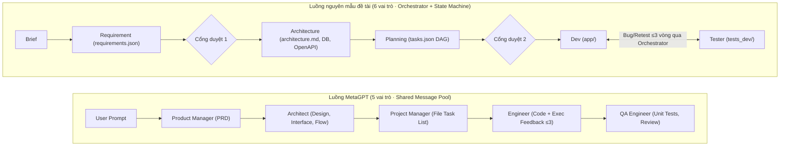

# BÁO CÁO NGHIÊN CỨU NGẮN CÔNG VIỆC R03

> **Mã công việc**: `R03` ([GitHub Issue #5](https://github.com/DaoNgocDinh/ChuyenDeKTPM/issues/5), thuộc kế hoạch tổng [#1](https://github.com/DaoNgocDinh/ChuyenDeKTPM/issues/1); tiền nhiệm: [`R01` (#3)](https://github.com/DaoNgocDinh/ChuyenDeKTPM/issues/3))  
> **Loại công việc**: Tìm hiểu · **Tuần tương đối**: Tuần 2  
> **Nhánh lưu trữ**: `R03` trên kho `DaoNgocDinh/ChuyenDeKTPM` (khởi tạo từ nền `main` commit `8c2fe71`)  
> **Ngày lập báo cáo**: 25/11/2026  
> **Trạng thái**: Đã lập bản báo cáo nhỏ `R03` trên nhánh riêng `R03` — **chờ chủ dự án rà soát và quyết định nghiệm thu** (chưa đóng Issue `#5`, chưa chuyển vào danh sách đã hoàn thành của sổ cái `R10`)  
> **Nguồn chuẩn đối chiếu**: `Ke_hoach_nghien_cuu_he_thong_Multi_Agent.docx` (17/11/2026; SHA256 `975228EA14EDCE90CFECBBFE05C9911DD33B35FD1A4ACEF75577A9499D884C9F`), mục `2.4–2.5`  
> **Đầu vào ghi chú của chủ dự án**: [Bình luận đợt 1 `#issuecomment-7167211721` (`22:40`, 25/11/2026 GMT+7)](https://github.com/DaoNgocDinh/ChuyenDeKTPM/issues/5#issuecomment-7167211721) và [bình luận hiệu chỉnh `#issuecomment-7167269005` (`22:42`, 25/11/2026 GMT+7)](https://github.com/DaoNgocDinh/ChuyenDeKTPM/issues/5#issuecomment-7167269005)  
> **Ranh giới báo cáo**: Đây là bản báo cáo ngắn phục vụ nghiệm thu riêng công việc **`R03`**, tách bạch rõ: (a) ý từ ghi chú của chủ dự án, (b) nội dung đối chiếu trực tiếp từ toàn văn bài báo gốc **MetaGPT** (`arXiv:2308.00352v7`), và (c) lựa chọn áp dụng/không áp dụng vào thiết kế nguyên mẫu 6 vai trò. Báo cáo **không** sao chép số vai trò của MetaGPT, **không** lấy số liệu của bài báo làm kết quả hay dự đoán hiệu năng cho đề tài, và **không** chứa dữ liệu chạy thật (`RQ1`–`RQ3` giữ mở).

---

## 1. Mục tiêu, tiền nhiệm và dấu vết ghi chú của chủ dự án

- **Mục tiêu (Issue `#5`)**: Đọc bài báo gốc **MetaGPT**, rút ra bài học phân vai theo SOP và hợp đồng bàn giao có cấu trúc phù hợp với nguyên mẫu 6 vai trò.
- **Tình trạng tiền nhiệm (`R01` — `#3`)**: Đã có báo cáo [`R01/bao_cao_R01.md`](https://github.com/DaoNgocDinh/ChuyenDeKTPM/blob/32b2ce78a1ab602259899d77d0943c624fd226d2/R01/bao_cao_R01.md) tại commit `32b2ce7` trên nhánh `R01`; Issue `#3` đã đóng trên GitHub nhưng vẫn chờ chủ dự án xác nhận nghiệm thu báo cáo trên sổ cái `R10`.
- **Diễn biến ghi chú của chủ dự án trên Issue `#5`**:
  1. **Đợt 1 (`#issuecomment-7167211721`)**: Ghi nhận bài toán *cascading hallucinations* khi ghép chuỗi LLM thiếu kiểm soát, định hướng MetaGPT kết hợp quy trình con người với đầu ra có cấu trúc. *(Lưu ý biên tập: câu diễn đạt ban đầu *"là 1 mô hình rất vượt trội đã được chứng minh"* có xu hướng khẳng định quá mạnh, và cách dịch *"chồng chéo ảo tưởng"*, *"lập trình siêu cấp"* nên chuẩn hóa thành **ảo giác lan truyền** và **lập trình meta / meta-programming**.)*
  2. **Đợt 2 (`#issuecomment-7167269005`)**: Chủ dự án đã **tự hiệu chỉnh rất đúng tinh thần kỷ luật bằng chứng**: nêu rõ MetaGPT tổ chức agent chuyên biệt theo **SOP** với đầu ra có cấu trúc để giảm mơ hồ/lỗi lan truyền; xác định mục tiêu áp dụng cho chuẩn hóa bàn giao **`Requirement → Architecture → Planning`** có kiểm tra trước khi chuyển bước; khẳng định **không sao chép số vai trò và không mặc định đạt hiệu quả như MetaGPT**; gắn đúng nguồn `https://arxiv.org/html/2308.00352v7`.
- **Phần bổ sung từ đối chiếu toàn văn nguồn gốc**: Hai bình luận của chủ dự án chưa liệt kê chi tiết kiến trúc 5 vai trò + `Publish–Subscribe` + `Executable Feedback`, dữ liệu/metric thực nghiệm, sơ đồ luồng, cột áp dụng/không áp dụng và hạn chế nguồn theo checklist Issue `#5`. Các mục `2`–`6` dưới đây tổng hợp trực tiếp từ toàn văn `arXiv:2308.00352v7` để chủ dự án rà soát trước khi nghiệm thu.

---

## 2. Tóm tắt bài báo MetaGPT có dẫn vị trí nguồn (`arXiv:2308.00352v7`)

### 2.1. Bài toán, kiến trúc 5 vai trò và cơ chế bàn giao

- **Bài toán giải quyết** *(Abstract, Sec. 1, Sec. 2, Sec. 3.2)*: Các hệ thống đa tác tử dựa trên LLM giải quyết được hội thoại đơn giản nhưng thường thất bại ở tác vụ phức tạp (như kỹ nghệ phần mềm) do **mất nhất quán logic** bắt nguồn từ **ảo giác lan truyền (*cascading hallucinations*)** khi ghép chuỗi LLM một cách đơn giản, giao tiếp ngôn ngữ tự nhiên tự do gây méo thông tin (hiệu ứng *"trò chơi truyền tin / Chinese whispers"*), tán gẫu thừa (*idle chatter*) và lỗi lặp chỉ dẫn/vòng lặp tin nhắn vô hạn (*assistant repeated instruction*, *infinite loop of message*).
- **Ý tưởng lõi — Mã hóa SOP thành chuỗi prompt** *(Abstract, Sec. 1, Sec. 3.1, Fig. 1)*: MetaGPT đưa **Quy trình thao tác chuẩn (*Standardized Operating Procedures — SOPs*)** của công ty phần mềm vào hệ thống đa tác tử theo mô hình **dây chuyền lắp ráp (*assembly line paradigm*)**, định nghĩa rõ vai trò, trách nhiệm và chuẩn sản phẩm trung gian.
- **Kiến trúc 5 vai trò chuyên biệt** *(Sec. 3.1, Fig. 1 & Fig. 3, Appendix B.2)*: Mỗi vai trò có hồ sơ (`name`, `profile`, `goal`, `constraints`), ngữ cảnh/công cụ riêng và hoạt động theo kiểu **ReAct-style** (`Yao et al., 2022`):
  1. **`Product Manager`**: Phân tích yêu cầu đầu vào → xuất **PRD** (Goals, User Stories, Competitive Analysis + quadrant chart, Requirement Analysis, Requirement Pool gắn độ ưu tiên P0/P1, UI draft, mục `Anything UNCLEAR`).
  2. **`Architect`**: Đọc PRD → xuất **System Design** (Implementation approach, File Lists, Data Structures & Interface Definitions / class diagram, Program Call Flow / sequence diagram).
  3. **`Project Manager`**: Đọc System Design → xuất **Tasks** (thư viện bên thứ ba, Full API spec, Logic Analysis, Task list chia theo từng tệp mã nguồn, Shared Knowledge).
  4. **`Engineer`**: Hiện thực từng tệp/lớp/hàm theo đặc tả thiết kế và task.
  5. **`QA Engineer`**: Sinh unit test và rà soát mã nguồn nhằm phát hiện và sửa lỗi.
- **Cơ chế giao tiếp & bàn giao hai lớp** *(Sec. 3.2, Fig. 2 trái, Appendix E.2)*:
  - **Giao diện giao tiếp có cấu trúc (*Structured Communication Interfaces*)**: Bắt buộc trao đổi qua **tài liệu và sơ đồ có khuôn mẫu/schema** thay vì đối thoại tự do như ChatDev.
  - **Bể thông điệp chung + Đăng ký theo vai trò (*Shared Message Pool & Publish–Subscribe*)**: Các agent xuất bản sản phẩm có cấu trúc lên bể thông điệp chung và chỉ đăng ký (*subscribe*) loại thông điệp liên quan đến profile của mình nhằm giảm quá tải thông tin; một agent chỉ kích hoạt hành động khi đã nhận đủ phụ thuộc đầu vào (*prerequisite dependencies*).
- **Cơ chế phản hồi thực thi (*Executable Feedback*)** *(Sec. 3.3, Fig. 2 phải)*: Khác với review chỉ bằng nhận xét văn bản dễ bỏ sót lỗi do ảo giác, `Engineer` tự viết và chạy unit test sau khi sinh mã ban đầu; nếu lỗi thì đối chiếu lịch sử chạy/gỡ lỗi trong bộ nhớ cùng PRD, System Design và mã nguồn để sửa lặp, **tối đa 3 lần thử lại (*maximum of 3 retries*)**.

### 2.2. Dữ liệu, Baseline, Metric và Kết quả chính trong bài báo *(chỉ tham khảo nguồn gốc)*

| Hạng mục | Nội dung từ `arXiv:2308.00352v7` | Vị trí nguồn |
|---|---|---|
| **Bộ dữ liệu** | (1) `HumanEval`: 164 bài lập trình hàm Python kèm test; (2) `MBPP`: 427 bài Python cơ bản kèm test; (3) `SoftwareDev` (tác giả tự tạo): 70 tác vụ phần mềm (mini-game, xử lý Excel, CRUD khách hàng Streamlit+SQLite, dashboard…), nhưng so sánh chính chỉ chọn **7 tác vụ**, ablation vai trò chỉ **2 tác vụ**, thử đổi LLM và mức độ prompt chọn **5 tác vụ** | Sec. 4.1, Sec. 4.4, Appendix C.1–C.2, Tables 3–6, 8–9 |
| **Baselines** | LLM đơn lẻ (AlphaCode, InCoder, CodeGeeX, CodeGen, Codex, CodeT, PaLM, GPT-4) trên HumanEval/MBPP; và **AutoGPT, LangChain (Python REPL), AgentVerse, ChatDev** trên SoftwareDev | Sec. 4.1, Fig. 4, Tables 1–2, 4 |
| **Metrics** | HumanEval/MBPP: `Pass@k` (unbiased, báo cáo `Pass@1`). SoftwareDev: **(A) Executability** (người chấm thang `1–4`: 1 hỏng → 4 hoàn hảo), **(B) Cost** (thời gian, token, chi phí `$`), **(C) Code Stats** (số tệp, LOC/tệp, tổng LOC), **(D) Productivity** (`token / tổng LOC`, càng thấp càng tốt), **(E) Human Revision Cost** (số lần người sửa tay, mỗi lần thường ≤ 3 dòng) | Sec. 4.1 |
| **Kết quả chính tác giả công bố** | • HumanEval / MBPP (`Pass@1`, GPT-4): **`85.9%`** / **`87.7%`**; *executable feedback* đóng góp **`+4.2%`** / **`+5.4%`**.   • SoftwareDev (Table 1): Executability **`3.75`** (w/o Feedback: `3.67`; ChatDev: `2.25`), thời gian `541s` (ChatDev `762s`), token `31,255` (ChatDev `19,292`, nhưng Productivity `124.3` vs `248.9` token/LOC), Human Revision Cost `0.83` (vs `2.5` của ChatDev và `2.25` w/o Feedback). Table 4 (7 tác vụ): MetaGPT `3.9` vs ChatDev `2.1` và AutoGPT/LangChain/AgentVerse `1.0`. Table 9 (70 tác vụ w/o Feedback): Executability TB `3.36`, chi phí TB `$1.12`/tác vụ.   • Ablation vai trò (Table 3, 2 tác vụ): tăng từ 1 vai trò (Engineer: Executability `1.0`, `10` lần sửa, `$0.915`) lên 4 vai trò (+Product, Architect, Project: Executability `4.0`, `2.5` lần sửa, `$1.385`). | Sec. 1, Sec. 4.2, Sec. 4.4, Fig. 4, Tables 1, 3–4, 9 |

> **Kỷ luật bằng chứng**: Toàn bộ con số trên là **kết quả của tác giả MetaGPT trên bộ thử của họ** (chủ yếu dùng `GPT-4`), **tuyệt đối không** phải kết quả, mục tiêu cam kết hay bằng chứng dự đoán hiệu năng cho nguyên mẫu 6 vai trò của đề tài.

---

## 3. Vẽ lại luồng hoạt động và bài học hợp đồng cho `Requirement / Architecture / Planning`

### 3.1. Vẽ lại luồng MetaGPT bằng lời của mình và so với luồng nguyên mẫu đề tài

- **Luồng MetaGPT (5 vai trò qua Shared Message Pool)**: Yêu cầu người dùng đi vào `Product Manager` → xuất PRD lên *message pool*. `Architect` đăng ký nhận PRD → xuất thiết kế giao diện & luồng gọi lên pool. `Project Manager` đăng ký nhận thiết kế → chia danh sách tệp/task lên pool. `Engineer` nhận từng task, sinh mã và chạy vòng *executable feedback* (tự viết/chạy unit test, sửa tối đa 3 lần). Cuối cùng `QA Engineer` viết thêm test và rà soát mã. Toàn bộ dây chuyền vận hành gần như thẳng một mạch theo sự kiện pub–sub, **không** có `Orchestrator + State Machine` kiểm soát chuyển bước tập trung và **không** có cổng duyệt bắt buộc của người dùng giữa các pha.
- **Điều chỉnh sang nguyên mẫu đề tài (6 vai trò có điều phối tập trung)**: Giữ mạch bàn giao có cấu trúc theo SOP (`Requirement → Architecture → Planning → Dev ↔ Tester`), nhưng đặt **`Orchestrator + State Machine`** làm trung tâm kiểm tra hợp lệ bằng chương trình (schema/tham chiếu/DAG), chèn **2 cổng duyệt người dùng** chống *stale approval*, tách cứng quyền ghi `app/` (`Dev`) với `tests_dev/` (`Tester`) qua **`Tool Gateway + MCP (stdio)`** và giữ bộ test nghiệm thu `evaluation/` hoàn toàn độc lập.

### 3.2. Điểm áp dụng cụ thể cho hợp đồng bàn giao `Requirement / Architecture / Planning`

| Vai trò trong đề tài | Gợi ý học từ SOP của MetaGPT *(Sec. 3.1–3.2, Appendix B.2)* | Chuẩn hóa hợp đồng & kiểm tra trước khi chuyển bước trong MVP |
|---|---|---|
| **`Requirement Agent`** | Học cấu trúc PRD rõ mục tiêu, user story, danh sách yêu cầu ưu tiên và mục **`Anything UNCLEAR`** để bộc lộ điểm mơ hồ sớm thay vì tự suy đoán | Xuất **`requirements.json`** (Pydantic/JSON Schema) + bản Markdown duyệt gồm `actors`, `FR` (ID duy nhất), `NFR`, `assumptions`, `questions`, `acceptance_criteria`. Kiểm tra bằng chương trình và **bắt buộc qua Cổng duyệt 1** mới mở `Architecture`. |
| **`Architecture Agent`** | Học cách chuyển yêu cầu thành cấu trúc kỹ thuật cụ thể (`File Lists`, `Data Structures`, `Interface Definitions`, `Sequence Flow`) giúp bước sau không bị thiếu hợp đồng | Đọc đúng `requirements` phiên bản đã duyệt; xuất **`architecture.md`**, ADR, sơ đồ thành phần, thực thể/quan hệ DB, **OpenAPI** và ánh xạ `requirement_refs` trong stack khóa cứng (`FastAPI + React + SQLite`). Kiểm tra bao phủ FR và nhất quán API/DB trước khi chuyển sang `Planning`. |
| **`Planning Agent`** | Học cách phân rã thiết kế thành danh sách công việc kỹ thuật nhỏ kèm phân tích phụ thuộc/thư viện thay vì ném toàn bộ thiết kế cho lập trình viên | Đọc đúng phiên bản `requirements` + `architecture`; xuất **`tasks.json`** dạng **DAG không chu trình** (mỗi task có `task_id`, `requirement_ids`, `dependency_ids`, tệp dự kiến, `done_conditions`, test cần chạy). Bắt buộc kiểm tra không chu trình, không sót FR và **qua Cổng duyệt 2 (gộp Architecture + Plan)** mới mở `Dev`. |

---

## 4. Bảng đối chiếu: Áp dụng và Không áp dụng (hoặc Điều chỉnh) vào nguyên mẫu

| Khía cạnh & vị trí nguồn MetaGPT | Áp dụng vào nguyên mẫu đề tài | Không áp dụng / Điều chỉnh bắt buộc trong MVP |
|---|---|---|
| **Phân vai chuyên môn** *(Sec. 3.1, Fig. 1)* | Áp dụng nguyên tắc phân tách trách nhiệm theo pha SDLC và gán hồ sơ/kỹ năng riêng cho từng vai trò (trong đề tài đóng gói thành 6 `SKILL.md`) | **Không sao chép 5 vai trò của MetaGPT.** Đề tài dùng **đúng 6 vai trò logic** (`Orchestrator`, `Requirement`, `Architecture`, `Planning`, `Dev`, `Tester`); bỏ phần *Competitive Analysis / Quadrant Chart* không cần thiết của `Product Manager`. |
| **SOP & đầu ra có cấu trúc** *(Sec. 1, 3.2, Appendix B)* | Áp dụng mạnh nguyên tắc cấm bàn giao bằng hội thoại tự do; mọi bước bàn giao bằng artifact có cấu trúc rõ ràng | Không chỉ dựa vào định dạng Markdown/block text bằng prompt như Appendix B; đề tài cưỡng chế bằng **JSON/Pydantic schema**, kiểm tra ngữ nghĩa (ID, FR, DAG), bất biến theo `version` + **`SHA256`** và `parent_refs`. |
| **Cơ chế điều phối & lọc ngữ cảnh** *(Sec. 3.2, Fig. 2, App. E.2)* | Học nguyên tắc mỗi vai trò chỉ nhận đúng artifact phụ thuộc đầu vào để tránh quá tải ngữ cảnh (*information overload*) | **Không dùng Shared Message Pool pub–sub mở** tự kích hoạt; thay bằng **`Orchestrator + State Machine` tập trung** (1 worker SQLite), có **2 cổng duyệt con người**, `cancel` và `checkpoint/pending_recovery`. |
| **Phản hồi thực thi & giới hạn thử lại** *(Sec. 3.3, Fig. 2 phải)* | Học nguyên lý **executable feedback** (phải chạy kiểm tra thật thay vì chỉ review văn bản) và đặt **giới hạn cứng 3 vòng sửa** | Không gộp quyền viết mã + tự nghiệm thu cho `Engineer` chạy shell tùy ý; đề tài tách cứng **`Dev`** (chỉ ghi `app/`) và **`Tester`** (chỉ ghi `tests_dev/`, kiểm thử & regression qua **`Tool Gateway + MCP stdio + Isolated Runner`** allowlist). |
| **Đánh giá & công bằng thực nghiệm** *(Sec. 4.1–4.4, Tables 1, 3)* | Tham khảo các nhóm chỉ số thực dụng: khả năng chạy được, thời gian, token/chi phí và số lần can thiệp của con người | **Không dùng chấm tay `Executability 1–4` hay tự sinh test làm chuẩn đánh giá cuối**, không dùng số liệu bài báo làm kết quả đề tài; dùng **bộ test nghiệm thu độc lập `evaluation/`** (10 tiêu chí/bài cho `A1–A3`) và **khóa cùng trần ngân sách tổng** giữa `S` và `M`. |

---

## 5. Hạn chế của nguồn và rủi ro khi chuyển kết quả tác giả sang đề tài

1. **Hạn chế do chính tác giả MetaGPT nêu *(Appendix D.1 & A.1)***:
   - *Phía hệ thống*: Chưa hỗ trợ tốt kịch bản **UI và front-end** (chưa có agent/công cụ đa phương thức) và vẫn khó đáp ứng yêu cầu phức tạp, đa dạng của ứng dụng thực tế.
   - *Phía người dùng*: **Khó ngắt giữa chừng tiến trình từng agent hoặc đặt điểm bắt đầu/checkpoint** — đây là lý do trực tiếp khiến đề tài bắt buộc thiết kế 2 cổng duyệt, `cancel` và `checkpoint/resume/pending_recovery`.
   - *Thiếu tích lũy xuyên dự án*: Bản chính chạy từng dự án độc lập; cơ chế *self-improvement* ở Appendix A.1 mới chỉ thử chỉnh *constraint prompt*, chưa cải tiến giao thức giao tiếp có cấu trúc.
2. **Khoảng cách phương pháp đánh giá và bối cảnh khi chuyển sang đề tài *(Sec. 4.1–4.4, Tables 1, 3–6, 8–9)***:
   - **Khác bản chất bài toán và cỡ mẫu nhỏ**: `HumanEval`/`MBPP` là bài toán 1 hàm Python; `SoftwareDev` chủ yếu là mini-game/script/Streamlit đơn lẻ (ví dụ bài CRUD dùng Streamlit+SQLite tại Table 8), so sánh chính với baseline chỉ trên **7 tác vụ** (Table 4) và ablation vai trò chỉ trên **2 tác vụ** (Table 3) — khác xa ứng dụng web full-stack `FastAPI + React + SQLite` của `A1–A3`.
   - **Đánh giá thủ công & thiên lệch tự sinh test**: `Executability (1–4)` và `Human Revision Cost` do người chấm; trong *executable feedback*, `Engineer` tự viết và tự chạy unit test nên dễ phát sinh dương giả nếu thiếu bộ kiểm thử nghiệm thu độc lập.
   - **Không giữ cố định ngân sách khi tăng số vai trò**: Ở Table 3, tăng từ 1 lên 4 vai trò làm chi phí tăng từ `$0.915` lên `$1.385` (+51%); trong khi `RQ1` của đề tài yêu cầu `S` và `M` **chia chung một trần ngân sách tổng**, nên không thể suy diễn từ Table 3 rằng `M` chắc chắn thắng `S`.
   - **Phụ thuộc mạnh vào model nền (Table 5)**: Cùng một SOP MetaGPT nhưng trên 5 tác vụ `SoftwareDev`, điểm Executability giảm từ **`3.8`** (`GPT-4`) xuống **`2.8`** (`GPT-3.5`) và **`1.4`** (`Deepseek Coder 33B`) — cho thấy kết quả phụ thuộc lớn vào năng lực LLM nền, không thể chuyển trực tiếp con số sang cấu hình model của đề tài.
   - **Thiếu kiểm soát bảo mật/quyền công cụ thực thi**: Bài báo không giải quyết phân quyền công cụ theo vai trò (`Tool Gateway`), chuẩn hóa MCP, chặn *path traversal* hay cô lập thư mục `evaluation/`.

---

## 6. Phiếu nguồn, đối chiếu tiêu chí `R03` và điểm còn mở

### 6.1. Phiếu nguồn của `R03` (đầu vào cho `R10`)

| # | Nguồn & đường dẫn | Phiên bản / Xuất bản | AI đối chiếu | Xác nhận tự đọc của chủ dự án | Phạm vi dùng & giới hạn |
|---|---|---|---|---|---|
| 1 | **S. Hong, M. Zhuge et al.** (Chenglin Wu, Jürgen Schmidhuber), *MetaGPT: Meta Programming for a Multi-Agent Collaborative Framework* — [arXiv HTML v7](https://arxiv.org/html/2308.00352v7) · [arXiv abs](https://arxiv.org/abs/2308.00352) | `arXiv:2308.00352v7 [cs.AI]`, `01/11/2024` (ICLR 2024; `[3]` trong kế hoạch) | Đã đọc toàn văn (`25/11/2026`) | Chủ dự án đã tóm tắt ý cốt lõi về SOP, đầu ra có cấu trúc & gắn link `v7` tại `#issuecomment-7167211721`, `#issuecomment-7167269005`; chờ tự xác nhận phạm vi/ngày đọc chi tiết các mục `3–4` và Phụ lục | Nguyên lý SOP, 5 vai trò, Structured Communication, Shared Message Pool/Pub–Sub, Executable Feedback (≤3 retries), dữ liệu/metric và hạn chế Appendix D.1; không sao chép số vai trò hoặc lấy số liệu làm kết quả đề tài |
| 2 | **Kế hoạch nghiên cứu đề tài**, `Ke_hoach_nghien_cuu_he_thong_Multi_Agent.docx` (mục `2.4–2.5`, `3.4`, `3.7`) | `17/11/2026`; SHA256 `975228EA…C9F` | Đã đối chiếu (`25/11/2026`) | Đã chốt phạm vi tại `P01` | Neo ranh giới 6 vai trò, hợp đồng artifact JSON/Pydantic và kỷ luật không nhận kết quả bài báo |

### 6.2. Bảng đối chiếu tiêu chí hoàn thành Issue `#5 [R03]`

| Hạng mục / Tiêu chí trong Issue `#5 [R03]` | Đáp ứng trong `R03/bao_cao_R03.md` | Trạng thái |
|---|---|---|
| Đọc bài MetaGPT gốc; ghi bài toán, kiến trúc, cơ chế bàn giao, dữ liệu và metric | Mục `2.1`, `2.2` và `6.1` (đủ bài toán, 5 vai trò, pub–sub, executable feedback, 3 dataset, baselines, metrics & kết quả dẫn đúng Sec./Table) | Đã trình bày — chờ chủ dự án rà soát |
| Vẽ lại luồng bằng lời của mình; nêu điểm áp dụng cho `Requirement`/`Architecture`/`Planning` | Mục `3.1` (diễn giải bằng lời + sơ đồ Mermaid đối chiếu) và Mục `3.2` (bảng áp dụng hợp đồng cho 3 vai trò) | Đã trình bày — chờ rà soát |
| Lưu phiếu nguồn và hạn chế khi chuyển kết quả của tác giả sang đề tài | Mục `5` (hạn chế Appendix D.1/A.1 + 5 khoảng cách thực nghiệm/bối cảnh) và Mục `6.1` (phiếu nguồn) | Đã trình bày — chờ rà soát |
| Có bản tóm tắt có dẫn vị trí/nguồn và cột áp dụng/không áp dụng | Mục `2` (dẫn rõ Sec./Fig./Table/Appendix) và Mục `4` (bảng đối chiếu cột *Áp dụng* / *Không áp dụng hoặc Điều chỉnh*) | Đã trình bày — chờ rà soát |
| Không sao chép số vai trò hoặc nhận số liệu của bài báo làm kết quả đề tài | Khẳng định tường minh tại Đầu báo cáo, Mục `1`, `2.2`, `4` và `5` | Đạt nội dung — chờ rà soát |

### 6.3. Điểm còn mở & Nhật ký hỗ trợ AI

- **Điểm cần chủ dự án tự kiểm tra trước khi nghiệm thu**:
  1. Hai bình luận gốc trên `#5` mới nêu ý khái quát về SOP và áp dụng cho `Requirement/Architecture/Planning`; chủ dự án cần đọc lại Mục `2.2`, `3`, `4`, `5` (đặc biệt cơ chế `Shared Message Pool / Pub–Sub`, `Executable Feedback ≤ 3`, cỡ mẫu nhỏ 7/2 tác vụ và hạn chế `Appendix D.1`) để tự giải thích trôi chảy bằng lời mình trước khi quyết định nghiệm thu.
  2. Chủ dự án cần xác nhận phạm vi/ngày tự đọc nguồn `arXiv:2308.00352v7` (cũng như xác nhận chuyển trạng thái nghiệm thu của `R01`, `R02` trên sổ cái `R10` nếu đã hoàn tất rà soát).
  3. Bước tiếp theo trong chuỗi nghiên cứu liên quan Tuần 2 là `R04` (ChatDev — `#6`), `R05` (SWE-agent — `#7`) và `R06` (SWE-bench — `#8`) để hợp nhất thành bảng so sánh 4 bài báo.
- **Nhật ký hỗ trợ AI**:
  - *Đầu vào*: Hai bình luận `#issuecomment-7167211721`, `#issuecomment-7167269005` trên Issue `#5`, toàn văn `https://arxiv.org/html/2308.00352v7` (tải và đối chiếu trực tiếp ngày `25/11/2026`), và `Ke_hoach_nghien_cuu_he_thong_Multi_Agent.docx` (mục `2.4–2.5`).
  - *Phạm vi hỗ trợ*: Anti tạo nhánh `R03` từ `main` (`8c2fe71`), biên soạn bản báo cáo nhỏ `R03/bao_cao_R03.md` đầy đủ tiêu chí Issue `#5`, cập nhật mục theo dõi chờ nghiệm thu tại `R10/so_cai_hoan_thanh.md` (nhánh `R10`) và đăng bình luận đối chiếu tại Issue `#12`.
  - *Giới hạn*: Báo cáo chưa có quyết định nghiệm thu của chủ dự án, không tự ghi thay ngày tự đọc chi tiết, không đóng Issue `#5` và không chứa dữ liệu thực nghiệm của đề tài.
