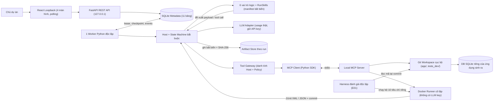
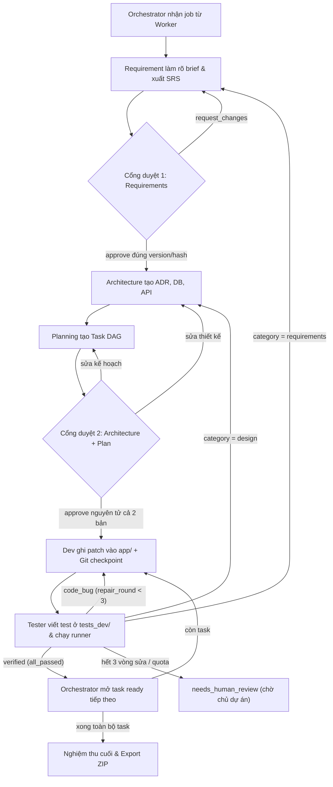
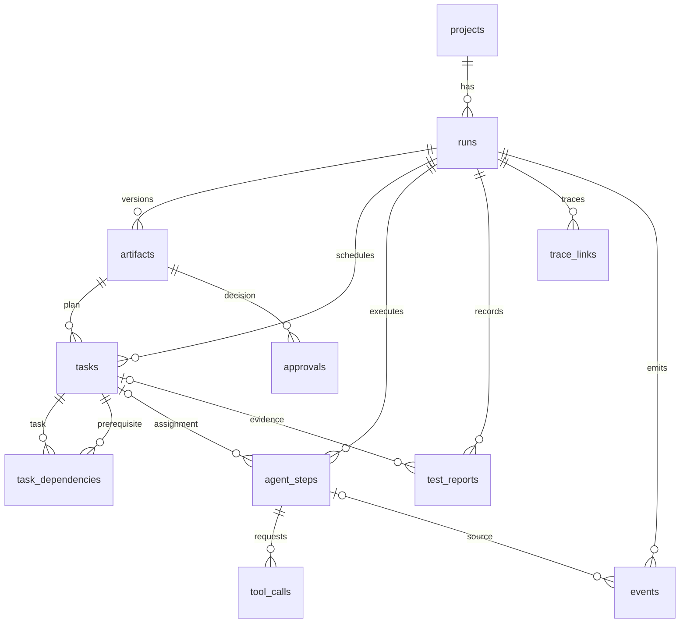
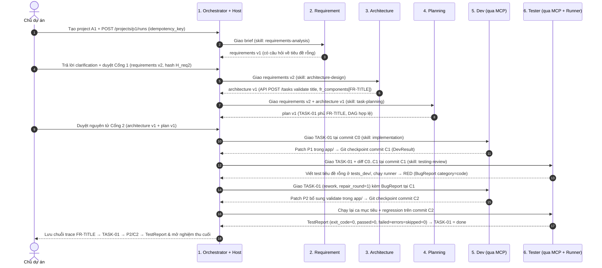

# Phần 3. Phân tích yêu cầu và thiết kế hệ thống

Bản thảo `B02` (Issue `#60`) tổng hợp toàn bộ phần phân tích yêu cầu và thiết kế kỹ thuật của nền tảng Multi-Agent sáu vai trò, bám sát nguồn chuẩn `Ke_hoach_nghien_cuu_he_thong_Multi_Agent.docx` (mục `3.1–3.12`, SHA-256 `975228EA14EDCE90CFECBBFE05C9911DD33B35FD1A4ACEF75577A9499D884C9F`), [đề cương P01](ke-hoach.md) và các nhánh thiết kế `D01`, `D05–D11`. Tài liệu được tách riêng ở `docs/bao-cao-phan-3.md` để ghép nối sạch với bản thảo `B01` (`docs/bao-cao.md`) khi hợp nhất báo cáo.

> **Trạng thái nguồn thiết kế tại thời điểm lập bản thảo (26/11/2026):**
> - **Đã ghi nhận chủ dự án duyệt trong tài liệu nguồn:** `P01` (`8c2fe71`), `D01` (`7071613`), `D02` (`65a3460`), `D03` (`fc91ea7`), `D04` (`2a6d8f0`), `D09` (`2263048`) và `D11` (`234ba3f`, đã có xác nhận duyệt ở bản làm việc cục bộ của `D11`).
> - **Đang ở trạng thái bản đề xuất chờ chủ dự án duyệt chính thức:** `D05` (`d2e38cd`), `D06` (`5afdf4b`), `D07` (`5499fac`), `D08` (`48006ea`), `D10` (`ec6e2f6`, OpenAPI `0.1.0-draft`).
> - **Quy tắc cập nhật:** Tài liệu này mô tả thiết kế nền tảng, chưa chứa kết quả chạy thực nghiệm. Khi triển khai thực tế (`I04–I25`) hoặc kiểm chứng (`V01–V02`) làm thay đổi hợp đồng, phải cập nhật đồng bộ tài liệu thiết kế nguồn, ghi rõ phiên bản/commit và cập nhật lại Phần 3 trước khi chốt `B06`.

---

## 3.1. Tác nhân sử dụng và các tình huống chính (Use Cases)

Nguồn: `D01` (`docs/nghiem-thu-nen-tang.md`, commit `7071613`) — **đã duyệt phạm vi**.

- **Tác nhân bên ngoài:**
  - **Chủ dự án / Người dùng cục bộ:** nhập đề bài (`brief`), trả lời câu hỏi làm rõ, duyệt tại hai cổng duyệt, theo dõi tiến độ/lỗi, điều khiển dừng/khôi phục, tải gói xuất và nghiệm thu cuối.
  - **Nhà cung cấp LLM:** trả phản hồi có cấu trúc và lời gọi công cụ qua lớp adapter thống nhất (`I04`); hiện ghi nhận cấu hình `gemini-4-neon-high` qua Antigravity CLI (`D08`/`R09`).
  - **Local MCP Server & Docker Runner:** thực thi các thao tác workspace, Git cục bộ và bộ kiểm thử trong phạm vi quyền do Host kiểm soát (`R07`, `D11`, `I13–I15`).
- **Tác nhân logic bên trong nền tảng:** đúng sáu vai trò `Orchestrator`, `Requirement`, `Architecture`, `Planning`, `Dev`, `Tester`.

| Mã UC | Luồng thao tác chính | Tác nhân kích hoạt | Kết quả và bằng chứng nền tảng phải lưu |
| --- | --- | --- | --- |
| **UC-01** | Tạo dự án và xếp hàng run | Chủ dự án | Lưu `project_id`, brief, ràng buộc; `POST /projects/{id}/runs` với `idempotency_key` ghi job bền vào SQLite và trả `202` kèm `run_id`. |
| **UC-02** | Làm rõ yêu cầu và duyệt Cổng 1 | Chủ dự án + `Requirement` | Ghi câu trả lời làm rõ theo đúng `artifact_id/version/sha256`; sinh `requirements` có phiên bản; khóa chuyển sang `Architecture` cho tới khi duyệt đúng phiên bản hiện hành. |
| **UC-03** | Duyệt gộp Thiết kế và Kế hoạch (Cổng 2) | Chủ dự án + `Architecture` + `Planning` | Trình bày đồng thời `architecture` và `plan` (DAG); ghi quyết định nguyên tử cho đúng cặp phiên bản/hash trước khi mở `Dev`. |
| **UC-04** | Triển khai mã, kiểm thử và vòng sửa lỗi | `Dev` + `Tester` + `Orchestrator` | `Dev` ghi patch trong `app/` kèm Git checkpoint; `Tester` viết test ở `tests_dev/`, chạy runner thật, xuất `test_report` và `bug_report`; định tuyến lỗi mã về `Dev` (tối đa 3 vòng sửa/task), lỗi yêu cầu/thiết kế về đúng vai trò nguồn. |
| **UC-05** | Giám sát lỗi, dừng và khôi phục | Chủ dự án + Worker | Ghi sự kiện `tool_denied`, `budget_exceeded`, lý do dừng; hỗ trợ `cancel` (dừng container/tiến trình con) và đối chiếu checkpoint vào `pending_recovery` sau restart khi tác dụng phụ chưa rõ. |
| **UC-06** | Xem chuỗi truy vết, xuất gói và nghiệm thu cuối | Chủ dự án | Hiển thị diff, bug, runner report, chuỗi `FR → task → patch → test`; tải ZIP đã lọc secret (`GET /runs/{id}/export`) và ghi quyết định nghiệm thu cuối gắn manifest. |

---

## 3.2. Đặc tả yêu cầu chức năng (FR01–FR10) và phi chức năng (NFR01–NFR08)

Nguồn: `D01` (`7071613`) — **đã duyệt phạm vi**. Các yêu cầu sau áp dụng cho **nền tảng**; yêu cầu nghiệp vụ của ba ứng dụng thử nghiệm (`A1`, `A2`, `A3`) là đầu vào riêng từng project (`D02–D04`).

### Bảng 3.1. Yêu cầu chức năng của nền tảng (`FR01–FR10`)

| Mã | Yêu cầu chức năng | Cách kiểm chứng và bằng chứng nghiệm thu dự kiến (`V01`) |
| --- | --- | --- |
| **FR01** | Quản lý dự án và lịch sử run | Tạo project với brief/ràng buộc rồi mở lại; tồn tại `project_id`, đọc lại đúng brief và ràng buộc ban đầu. |
| **FR02** | Phân tích yêu cầu và làm rõ | Gửi đề bài thiếu thông tin, trả lời câu hỏi rồi xem SRS; `requirements.json` hợp schema có tác nhân, FR, NFR, giả định, câu hỏi và tiêu chí chấp nhận. |
| **FR03** | Hai cổng duyệt chống stale approval | Thử đi tiếp khi chưa duyệt, yêu cầu sửa rồi duyệt đúng phiên bản tại cả hai cổng; quyết định cho phiên bản cũ bị từ chối (`409 approval_version_conflict`). |
| **FR04** | Thiết kế kiến trúc và lập kế hoạch DAG | Duyệt yêu cầu rồi mở đầu ra của `Architecture` và `Planning`; có ADR, DB schema, API contract và danh sách task/dependency không chu trình bao phủ đủ FR. |
| **FR05** | Sinh mã theo task có Git checkpoint | Giao task cho `Dev` rồi kiểm tra workspace của run; patch/diff chỉ sửa vùng cho phép và gắn `input_commit`, `output_commit`, `patch_sha256`. |
| **FR06** | Review, kiểm thử phát triển và báo lỗi có bằng chứng | Cho `Tester` kiểm tra bản mã có lỗi tái hiện được; có test trong `tests_dev/`, review, báo cáo runner thật và `bug_report` có bước tái hiện. |
| **FR07** | Vòng phản hồi sửa lỗi có giới hạn và định tuyến đúng vai trò | Thử lỗi mã, lỗi thiết kế, lỗi yêu cầu và task lỗi quá 3 vòng sửa; log định tuyến đúng vai trò, dừng task ở trạng thái `blocked` và run ở `needs_human_review` trước vòng sửa thứ 4. |
| **FR08** | Quản lý Skill và kiểm soát công cụ qua MCP | Kiểm tra manifest hash 6 skill, log gọi tool hợp lệ qua MCP và bản ghi từ chối cho yêu cầu ngoài quyền vai trò. |
| **FR09** | Lưu artifact có phiên bản và truy vết đầy đủ | Từ một FR của ứng dụng, lần theo `trace_links` và `events` tới đúng `task → patch → test_report` cùng run và đúng phiên bản. |
| **FR10** | Dừng, khôi phục sau restart và xuất gói sản phẩm | Dừng run, khởi động lại worker, đọc lại trạng thái/checkpoint và tải ZIP mở được gồm mã, README, tài liệu duyệt và test report đúng run. |

### Bảng 3.2. Yêu cầu phi chức năng của nền tảng (`NFR01–NFR08`)

| Mã | Yêu cầu phi chức năng | Cách kiểm chứng và bằng chứng nghiệm thu dự kiến (`V01`/`V02`) |
| --- | --- | --- |
| **NFR01** | Một run chạy tại một thời điểm (1 worker) | Gửi 2 run liên tiếp khi run 1 đang chạy; chỉ 1 run ở `running`, run 2 ở `queued`, hai workspace tách biệt tuyệt đối. |
| **NFR02** | Bền trạng thái và phục hồi an toàn | Ngắt worker giữa thao tác có tác dụng phụ chưa rõ rồi bật lại; giữ artifact cũ, đưa run về `pending_recovery` thay vì tự chạy lại mù quáng. |
| **NFR03** | Giới hạn vòng lặp và ngân sách | Đặt trần thời gian/tool call/token thấp và ép task lỗi lặp; dừng đúng lý do, mỗi task tối đa 3 vòng sửa sau lần triển khai đầu. |
| **NFR04** | Cô lập quyền theo vai trò và đường dẫn | Thử `Tester` sửa `app/`, `Dev` sửa `evaluation/` và path traversal/symlink ngoài workspace; tầng thực thi chặn trước tác dụng phụ, file đích giữ nguyên. |
| **NFR05** | Khả năng tái lập cấu hình run | Đối chiếu đầy đủ `model_id`, `prompt_hash`, `skill_hash`, lockfile, schema tool, đầu vào và commit mã trên cùng run. |
| **NFR06** | Không rò rỉ secret/credential | Dùng chuỗi canary giả làm API key trong kiểm thử; chuỗi canary không xuất hiện trong repo, prompt, artifact, DB, log lỗi hay ZIP xuất. |
| **NFR07** | Bằng chứng kiểm thử xác thực | Đối chiếu `test_reports` với tệp JUnit XML/JSON gốc từ runner; khớp `exit_code`, số `passed/failed/skipped/errors`, thời lượng và commit mã. |
| **NFR08** | Khả năng quan sát trên giao diện | Mở giao diện khi đang chạy, chờ duyệt và gặp lỗi; hiển thị rõ stage/step hiện tại, artifact cần duyệt, lý do dừng và `next_actions` hợp lệ. |

---

## 3.3. Hợp đồng sáu vai trò logic và ánh xạ Skill khởi đầu

Nguồn: `D05` (`d2e38cd`, **đề xuất chờ duyệt**) và `I08` (`960f1a8`, registry 6 skill khóa manifest). Nguyên tắc xuyên suốt: Host gắn danh tính tin cậy (`project_id`, `run_id`, `step_id`, `role`, `task_id`, `input_commit`) từ trạng thái lưu trong SQLite; model chỉ đề xuất nội dung/tham số nghiệp vụ, không tự cấp quyền hay tự chuyển trạng thái.

| Vai trò logic | Skill ánh xạ 1–1 (`skills/<name>/SKILL.md`) | Đầu vào bắt buộc do Host cấp | Sản phẩm bàn giao bắt buộc | Phạm vi ghi & điểm dừng |
| --- | --- | --- | --- | --- |
| **Orchestrator** | `workflow-coordination` | Brief, stage, checkpoint, quota, artifact đã duyệt hoặc kết quả bước trước | Đề xuất giao việc (`dispatch`), yêu cầu duyệt, tổng hợp kết quả | Chỉ ghi metadata/sự kiện qua dịch vụ Host sau khi qua state machine; dừng chờ chủ dự án tại 2 cổng và khi chạm ngưỡng lỗi/quota. |
| **Requirement** | `requirements-analysis` | Brief, ràng buộc, câu trả lời làm rõ, bản `requirements` cũ (nếu sửa) | `Requirements` JSON + Markdown cùng phiên bản và câu hỏi chặn | Ghi phiên bản mới qua Artifact Store; dừng nếu còn câu hỏi chặn hoặc chờ duyệt Cổng 1. |
| **Architecture** | `architecture-design` | `Requirements` đúng phiên bản đã duyệt và ràng buộc stack cố định | `Architecture` (ADR, thành phần, thực thể, API, FE, chiến lược test, `fr_components`) | Ghi phiên bản mới qua Artifact Store; trả blocker về `Requirement` nếu yêu cầu mâu thuẫn; Host kiểm tra phủ 100% FR. |
| **Planning** | `task-planning` | `Requirements` đã duyệt + `Architecture` đúng phiên bản | `Plan` gồm danh sách `Task` tạo thành DAG không chu trình | Ghi phiên bản mới qua Artifact Store; không trộn lập kế hoạch với viết mã; đi cùng `Architecture` vào Cổng 2. |
| **Dev** | `implementation` | Task ở `ready`/`rework`, cặp artifact đã duyệt, `input_commit`, `BugReport` (nếu sửa) | Patch trong `app/` + `DevResult` (`input_commit`, `output_commit`, `patch_sha256`, `changed_files`) | Chỉ ghi trong `app/` của đúng run qua Gateway/MCP; được chạy suite `build`/`smoke`/`development`; không tự đánh dấu hoàn tất nghiệm thu. |
| **Tester** | `testing-review` | FR, tiêu chí chấp nhận, task, diff và `output_commit` của `Dev` | Test phát triển trong `tests_dev/`, `TestReport` từ runner thật, review và `BugReport` (nếu đỏ) | Chỉ ghi trong `tests_dev/` và báo cáo/bug của run; không sửa `app/`, không truy cập `evaluation/`; định tuyến bug mã về `Dev`, lỗi yêu cầu/thiết kế về vai trò tương ứng. |

**Cơ chế khóa Skill (`I08` — `backend/skill_registry.py`):** Trước lần gọi model đầu tiên của run (và khi resume), `RunSkills(skills_root, enabled=...).bind(run_dir / "skills.json")` xác minh cả 6 skill thuộc cùng một commit hệ thống, ghi tên, phiên bản, commit, SHA-256 và cờ `enabled` bằng liên kết nguyên tử. Chế độ thí nghiệm bỏ skill (`E06`) giữ nguyên toàn bộ role/tool policy và trả ngữ cảnh hướng dẫn rỗng (`""`).

---

## 3.4. Kiến trúc tổng thể và luồng điều phối

Nguồn: `D06` (`5afdf4b`, **đề xuất chờ duyệt**) và `R09` (`5abff40`, ADR chọn runtime state machine Python + 1 worker cục bộ).

### Hình 3.1. Kiến trúc thành phần và ranh giới dữ liệu/thực thi



### Hình 3.2. Luồng điều phối 6 vai trò, hai cổng duyệt và vòng phản hồi



**Ranh giới lưu trữ vật lý (`D06`, `D09`):**
- Metadata vận hành nằm trong SQLite nền tảng (11 bảng); cơ sở dữ liệu nghiệp vụ của ứng dụng sinh ra tách biệt hoàn toàn bên trong `workspaces/{project_id}/{run_id}/app/`.
- Thư mục mỗi run gồm `app/` (kho Git riêng), `tests_dev/`, `artifacts/` (blob bất biến công bố bằng hard link nguyên tử — `I03`) và `logs/` (đã lọc secret).
- `evaluation/` nằm hoàn toàn ngoài quyền đọc/ghi của `Dev`, `Tester` và container kiểm thử phát triển.

---

## 3.5. Hợp đồng Envelope, Artifact có phiên bản và kiểm tra bàn giao

Nguồn: `D07` (`5499fac`, `backend/contracts.py`, **đề xuất chờ duyệt**) và `I03` (`551b268`). Mọi mô hình Pydantic dùng `ConfigDict(extra="forbid", frozen=True, strict=True)` nhằm từ chối thuộc tính ngoài schema và cấm đột biến dữ liệu sau khi khởi tạo.

| Thực thể (`backend/contracts.py`) | Các trường cốt lõi | Ràng buộc xác thực tự động |
| --- | --- | --- |
| **`ArtifactRef`** | `run_id`, `artifact_id`, `version` (`>= 1`), `sha256` (64 ký tự hex) | Định danh duy nhất một phiên bản artifact bất biến trong đúng run. |
| **`Envelope`** | `message_id`, `run_id`, `from_role`, `to_role`, `kind`, `schema_version="1"`, `input_refs`, `output_refs`, `task_id`, `correlation_id` | Validator `same_run`: mọi tham chiếu trong `input_refs` và `output_refs` phải khớp `run_id` của envelope. |
| **`Requirements`** | `actors`, `functional`, `nonfunctional`, `assumptions`, `questions` | Tối thiểu 1 actor, 1 FR; mỗi mục có tối thiểu 1 `acceptance`; validator `unique_ids` cấm trùng mã FR/NFR. |
| **`Architecture`** | `requirements` (`ArtifactRef`), `adr`, `components`, `entities`, `api_contract`, `frontend`, `test_strategy`, `fr_components` | Phải liên kết đúng bản `requirements` nguồn; mọi FR ánh xạ tới ít nhất một component đã khai báo trong `components`. |
| **`Plan` & `Task`** | `requirements`, `architecture`, `tasks` (`task_id`, `requirement_ids`, `dependencies`, `files`, `done_conditions`, `tests`) | Validator `check_dag` kiểm trùng `task_id`, phụ thuộc không tồn tại, phát hiện chu trình bằng `TopologicalSorter` và cấm ghép input khác run. |
| **`DevResult`** | `task_id`, `input_commit`, `output_commit`, `patch_sha256`, `changed_files`, `summary` | Commit phải là SHA-1 (40 hex) hoặc SHA-256 (64 hex); tối thiểu 1 tệp thay đổi. |
| **`TestReport`** | `task_id`, `commit`, `suite_id`, `runner_output` (`ArtifactRef`), `exit_code`, `passed`, `failures`, `errors`, `skipped` | Thuộc tính `all_passed` chỉ đúng khi `exit_code == 0`, `passed > 0` và `failures == errors == skipped == 0`. |
| **`BugReport`** | `task_id`, `commit`, `report` (`ArtifactRef`), `requirement_ids`, `reproduce`, `expected`, `actual`, `category` | `category` thuộc 4 nhóm bắt buộc: `code`, `requirements`, `design`, `infrastructure`; tối thiểu 1 bước tái hiện. |

Hàm `check_handoff(requirements, architecture, plan, requirement_ref, architecture_ref)` kiểm tra đồng thời chống phiên bản cũ (`stale artifact inputs`), phủ 100% mã FR ở cả `Architecture` lẫn `Plan` và tính hợp lệ của component/NFR trước khi cho phép vào Cổng duyệt 2. Khi JSON không hợp lệ, Host trả lỗi xác thực cho đúng vai trò sửa trong giới hạn thử lại, tuyệt đối không tự xóa trường hay điền dữ liệu giả.

---

## 3.6. Máy trạng thái (State Machine), Quota và Cơ chế phục hồi

Nguồn: `D08` (`48006ea`, `backend/lifecycle.py`, **đề xuất chờ duyệt**). Chỉ Host được phép áp dụng chuyển trạng thái sau khi kiểm tra guard; `stage` (`requirements`, `architecture`, `planning`, `development`, `testing`) lưu tách biệt với trạng thái vòng đời run.

### Bảng 3.3. Bảng chuyển trạng thái `RunState` (8 trạng thái) và `TaskState` (7 trạng thái)

| Máy trạng thái | Trạng thái hiện tại | Sự kiện (`event`) | Trạng thái đích | Guard & ghi chú vận hành |
| --- | --- | --- | --- | --- |
| **Run** | `queued` | `claim` | `running` | Worker lấy job trong transaction ngắn, gắn `worker_lease` duy nhất. |
| **Run** | `running` | `request_approval` | `waiting_approval` | Dừng tại Cổng 1 hoặc Cổng 2 cùng danh sách artifact hiện hành. |
| **Run** | `waiting_approval` | `approve_current` / `request_revision` | `queued` | Khớp đúng `version` + `sha256`; nếu sửa thì tạo bản mới và vô hiệu duyệt phụ thuộc. |
| **Run** | `running` | `effects_uncertain` / `lease_expired` | `pending_recovery` | Xảy ra khi worker mất lease hoặc tác dụng phụ Git/tool chưa có receipt xác nhận. |
| **Run** | `pending_recovery` | `reconciled` | `queued` | Chỉ chuyển sau khi đối chiếu checkpoint/receipt hoặc được chủ dự án xác nhận. |
| **Run** | `running` | `quota_exceeded` / `repairs_exhausted` | `needs_human_review` | Hết ngưỡng thời gian/tool call/token hoặc một task hỏng sau đủ 3 vòng sửa. |
| **Run** | `needs_human_review` | `owner_resume` | `queued` | Chủ dự án xem lý do/bằng chứng rồi quyết định tiếp tục. |
| **Run** | `running` | `final_checks_passed` / `irrecoverable_error` | `completed` / `failed` | Trạng thái kết thúc của run. |
| **Run** | `queued`, `running`, `waiting_approval`, `pending_recovery`, `needs_human_review` | `cancel` | `cancelled` | Thu hồi lease, dừng tiến trình/container con; run `cancelled` không tự chạy lại. |
| **Task** | `todo` → `ready` → `in_progress` → `waiting_test` | `dependencies_done` → `start` → `patch_committed` | `waiting_test` | Chỉ mở task khi toàn bộ `depends_on_task_id` đã `done`. |
| **Task** | `waiting_test` | `verified` / `code_bug` (`repair_count < 3`) / `code_bug` (`repair_count == 3`) | `done` / `rework` / `blocked` | Lần triển khai đầu có `repair_count = 0`; từ `rework` gọi `start` quay lại `in_progress`. |

**Chính sách Quota và Phục hồi (`D08`):**
- **Quota:** Kiểm tra trước mỗi lượt gọi model/tool; cấu hình hiện tại của chủ dự án dùng một model `gemini-4-neon-high` và không đặt trần token phía ứng dụng, vẫn ghi đầy đủ usage thực tế; hạn mức thời gian và số tool call toàn run sẽ khóa tại `E04` sau 3 run pilot.
- **Đối chiếu phục hồi (`recovery_action`):** Trước mọi tác dụng phụ patch/test, Host ghi `Checkpoint(operation_id, input_commit, patch_hash, output_commit=None)`. Sau restart, chỉ trả `advance_without_replay` khi `receipt` tồn tại, có `output_commit` khớp đúng `HEAD` hiện tại và trùng khớp bộ `(operation_id, input_commit, patch_hash)`. Mọi trường hợp thiếu hoặc lệch bằng chứng đều giữ `pending_recovery`.

---

## 3.7. Thiết kế dữ liệu SQLite của nền tảng (ERD 11 bảng)

Nguồn: `D09` (`2263048`, `backend/migrations/001_platform.sql`) — **chủ dự án đã duyệt**.

### Hình 3.3. Sơ đồ quan hệ thực thể (ERD) metadata nền tảng



### Bảng 3.4. Danh mục 11 bảng và các ràng buộc toàn vẹn chính (`001_platform.sql`)

| # | Tên bảng | Khóa & ràng buộc bảo vệ dữ liệu chính |
| --- | --- | --- |
| 1 | `projects` | `PK(id)`; lưu `name`, `brief_uri`, `created_at`. |
| 2 | `runs` | `PK(id)`, `FK(project_id)`, `UNIQUE(project_id, idempotency_key)`, partial unique index `one_running_worker ON runs(status) WHERE status = 'running'` cưỡng chế tối đa 1 run đang chạy. |
| 3 | `artifacts` | `PK(run_id, id)`, `UNIQUE(run_id, type, version)`, `UNIQUE(run_id, id, version, sha256)`; 3 trigger `artifacts_no_replace`, `artifacts_no_update`, `artifacts_no_delete` cưỡng chế bất biến. |
| 4 | `tasks` | `PK(run_id, id)`, `FK(run_id, plan_artifact_id)` trỏ `artifacts`; `CHECK(repair_round BETWEEN 0 AND 3)` và ràng buộc 7 trạng thái `TaskState`. |
| 5 | `task_dependencies` | `PK(run_id, task_id, depends_on_task_id)`, `CHECK(task_id <> depends_on_task_id)` cấm tự phụ thuộc, khóa ngoại cùng `run_id`. |
| 6 | `agent_steps` | `PK(run_id, id)`, `CHECK(agent_role IN ('orchestrator','requirement','architecture','planning','dev','tester'))`, `attempt >= 1`, `usage_json` cho phép `NULL` khi chưa có usage. |
| 7 | `tool_calls` | `PK(id)`, `UNIQUE(run_id, operation_id)`, `FK(run_id, step_id)`; lưu `request_redacted_json`, `result_uri`, `status`, `duration_ms`. |
| 8 | `approvals` | `PK(id)`, khóa ngoại ghép `FOREIGN KEY (run_id, artifact_id, artifact_version, artifact_sha256)` tham chiếu trực tiếp `artifacts`, ngăn duyệt sai phiên bản/hash ngay ở tầng DB. |
| 9 | `test_reports` | `PK(id)`, `FK(run_id)`, `FK(run_id, task_id)`; lưu `commit_hash`, `suite_id`, `report_uri`, `exit_code`, `passed`, `failed`, `skipped`, `errors`, `duration_ms`. |
| 10 | `trace_links` | `PK(id)`, `FK(run_id)`, chỉ mục `trace_source` và `trace_target` nối `source_type/id → target_type/id` kèm `evidence_uri`. |
| 11 | `events` | `PK(id)` tăng dần dùng làm cursor polling, `FK(run_id)`, `FK(run_id, step_id)`, chỉ mục `events_by_run(run_id, id)`. |

**Quy tắc kết nối & migration:** Bật `PRAGMA foreign_keys = ON` trên từng connection trước transaction đầu tiên; quản lý phiên bản bằng `PRAGMA user_version = 1` trong transaction `BEGIN IMMEDIATE`; giải phóng khóa DB trước khi gọi model, Git hay Docker runner.

---

## 3.8. Thiết kế API nền tảng (OpenAPI 3.1) và 4 màn hình MVP

Nguồn: `D10` (`ec6e2f6`, `docs/api-va-man-hinh.md` và `docs/openapi.json` `0.1.0-draft`, **đề xuất chờ duyệt**). API chỉ lắng nghe trên loopback `http://127.0.0.1:{port}` (mặc định `8000`), xác thực phạm vi sở hữu cục bộ theo cặp `project_id`/`run_id` trên mọi thao tác.

### Bảng 3.5. 14 Endpoint REST API và ánh xạ vào 4 màn hình React

| Màn hình MVP | Method & Path | Chức năng chính & hành vi bắt buộc |
| --- | --- | --- |
| **1. Dự án & Lịch sử run** | `GET /projects`, `POST /projects` | Liệt kê và tạo dự án (`201`, đầu vào `name`, `brief`, `constraints`). |
| **1. Dự án & Lịch sử run** | `GET /projects/{project_id}/runs`, `POST /projects/{project_id}/runs` | Xem lịch sử run và xếp hàng job mới (`202 RunTicket`) theo `idempotency_key`; gửi trùng khóa + cùng payload trả cùng `run_id`, đổi cấu hình trả `409 idempotency_conflict`. |
| **2. Chi tiết run & Timeline** | `GET /runs/{run_id}`, `GET /runs/{run_id}/events?after={cursor}` | Đọc trạng thái, `stage`, `quota` (`usage_complete`), `last_error`, `next_actions`; poll sự kiện theo `sequence > after`, giữ nguyên cursor trên trang rỗng. |
| **2. Chi tiết run & Timeline** | `POST /runs/{run_id}/clarifications`, `POST /runs/{run_id}/cancel`, `POST /runs/{run_id}/resume` | Trả lời câu hỏi gắn đúng `ArtifactRef`; yêu cầu dừng (`202`) hoặc khôi phục (`202`); chuyển trạng thái không hợp lệ trả `409 invalid_transition`. |
| **3. Duyệt artifact** | `GET /runs/{run_id}/artifacts`, `GET /artifacts/{artifact_id}?run_id=...` | Liệt kê và đọc nội dung artifact kèm `previous_artifact_id` để so sánh; sai `run_id` trả `404 not_found`. |
| **3. Duyệt artifact** | `POST /runs/{run_id}/approvals` | Duyệt hoặc `request_changes` (bắt buộc `comment`) nguyên tử cho Cổng 1 (`1` artifact `requirements`) hoặc Cổng 2 (`2` artifact `architecture` + `plan`); sai phiên bản/hash trả `409 approval_version_conflict`. |
| **4. Mã, Kiểm thử, Truy vết & Export** | `GET /runs/{run_id}/tasks`, `GET /runs/{run_id}/test-reports` | Hiển thị DAG task (`requirement_ids`, `dependency_ids`, `patch_artifact_ids`), kết quả runner riêng biệt (`passed/failed/skipped/errors`, `exit_code`, `commit`), bug và trace artifact. |
| **4. Mã, Kiểm thử, Truy vết & Export** | `GET /runs/{run_id}/export`, `POST /runs/{run_id}/acceptance` | Tải gói `application/zip` đã lọc secret và ghi quyết định nghiệm thu cuối gắn đúng `manifest` (`ArtifactRef`). |

**Bộ mã lỗi thống nhất (`components.schemas.Error`):** `not_found`, `approval_version_conflict`, `invalid_transition`, `tool_denied`, `budget_exceeded`, `invalid_request`, `idempotency_conflict`. Hai mã `tool_denied` và `budget_exceeded` phát sinh bất đồng bộ từ worker và xuất hiện trong `Run.last_error` cùng timeline sự kiện.

---

## 3.9. Ma trận quyền công cụ MCP, Threat Model và Docker Runner Profile

Nguồn: `D11` (`234ba3f`, `docs/quyen-va-runner.md`, `docs/quyen-cong-cu.json` — **đã duyệt thiết kế và giới hạn khởi đầu**), kết hợp kiểm chứng giao thức MCP `stdio` tại `R07` (`36d1d2c`) và Gateway/Workspace tại `I12–I13`.

### Bảng 3.6. Ma trận quyền và nhóm công cụ MCP theo vai trò (`docs/quyen-cong-cu.json`)

| Vai trò | Công cụ đọc được phép (`read`) | Vùng ghi (`write`) | Suite runner (`suites`) | Đầu ra do Host ghi (`host_outputs`) |
| --- | --- | --- | --- | --- |
| **Orchestrator** | `project.read_artifact` | *(không)* | *(không)* | `dispatch`, `checkpoint`, `event` |
| **Requirement** | `project.read_artifact` | *(không)* | *(không)* | `requirements`, `clarification` |
| **Architecture** | `project.read_artifact` | *(không)* | *(không)* | `architecture` |
| **Planning** | `project.read_artifact` | *(không)* | *(không)* | `plan` |
| **Dev** | `project.read_artifact`, `workspace.list_files`, `workspace.read_file`, `git.status`, `git.diff` (`read_roots`: `app`, `tests_dev`) | `app` | `build`, `smoke`, `development` | `patch_reference` |
| **Tester** | `project.read_artifact`, `workspace.list_files`, `workspace.read_file`, `git.status`, `git.diff` (`read_roots`: `app`, `tests_dev`) | `tests_dev` | `build`, `smoke`, `development` | `review`, `bug_report` |

**Hợp đồng tham số và cô lập thực thi:**
- **Ngữ cảnh tin cậy (`trusted_context`):** `project_id`, `run_id`, `step_id`, `role`, `task_id`, `input_commit` do Host tra từ SQLite; Gateway từ chối mọi trường ngoài schema của tool (kể cả khi model tự khai báo `role`/`run_id`).
- **Thao tác workspace & Git (`I12`):** Đường dẫn tương đối trong root được cấp, chặn đường dẫn tuyệt đối/UNC/symlink thoát root; mọi patch gắn `task_id`, `input_commit`, `expected_hash`, ghi journal trước tác dụng phụ và Host tạo commit checkpoint cục bộ (cấm `push`/`force-push`).
- **Docker Runner Profile đã duyệt (`D11`):**
  - `backend: "docker"`, `privileged: false`, `host_socket: false`, `read_only_root: true`, `run_as_root: false`.
  - Mạng: `dependency_fetch = owner_permits_required_downloads`, `test_egress = docker_bridge_outbound_internet` (không dùng host network, không publish cổng).
  - Giới hạn khởi đầu mỗi lượt: **2 CPU**, **2 GiB RAM** (`2147483648` byte), **128 PID**, **180 giây timeout**, **1 MiB log** (`1048576` byte); `environment_allowlist: []` (không truyền LLM API key).
  - Bộ nghiệm thu độc lập: `independent_suite_access = evaluation_host_only` — không bao giờ gắn vào container của `Dev`/`Tester`.
- **Threat model (6 nhóm rủi ro bắt buộc kiểm chứng tại `I13–I15`/`V02`):** (1) giả vai trò / khác run / hết lease, (2) path traversal & symlink thoát workspace, (3) prompt injection từ mã nguồn hoặc output tool, (4) rò rỉ credential qua log/exception/ZIP (kiểm bằng canary), (5) suite treo hoặc bỏ sót container/tiến trình con khi timeout/cancel, (6) báo cáo test giả/rỗng hoặc lệch commit mã.

---

## 3.10. Ví dụ minh họa một task đi xuyên đủ sáu vai trò

> **Ghi chú ranh giới:** Đây là **fixture minh họa kiểm chứng hợp đồng thiết kế** lấy theo `D02` (`A1-05`), `D05` và `D06` để kiểm tra đường đi qua cả sáu vai trò; **không phải** log chạy thực nghiệm của hệ thống.

**Ngữ cảnh:** Dự án `A1` (Quản lý công việc), yêu cầu nghiệp vụ `FR-TITLE` (*từ chối tạo công việc có tiêu đề rỗng*, tương ứng tiêu chí độc lập `A1-05`).



**Đường kiểm tra rẽ nhánh ngoại lệ trên cùng task:**
- Nếu chủ dự án bấm duyệt với hash cũ của `requirements v1` sau khi đã có `v2`: Host từ chối `409 approval_version_conflict`, không mở `Architecture`.
- Nếu `Dev` cố ghi vào `tests_dev/` hoặc `evaluation/`: Tool Gateway chặn trước tác dụng phụ, ghi sự kiện `tool_denied`.
- Nếu sau đủ 3 vòng sửa (`repair_round = 3`) mà test tại `Tester` vẫn đỏ: `TASK-01` chuyển `blocked`, run chuyển `needs_human_review` kèm toàn bộ bằng chứng commit/report cho chủ dự án quyết định.
- Nếu `Tester` xác định lỗi do tiêu chí yêu cầu mâu thuẫn (`category = requirements`): `Orchestrator` định tuyến về `Requirement` để tạo `requirements v3`, vô hiệu duyệt phụ thuộc và yêu cầu chủ dự án duyệt lại trước khi `Dev` chạy tiếp.

---

## 3.11. Rà soát tính nhất quán giữa các hợp đồng `D01–D11`

Khi đối chiếu trực tiếp mã và đặc tả trên các nhánh `D01` và `D05–D11`, phần lớn khái niệm lõi (6 vai trò, 2 cổng duyệt, 8 trạng thái run, 7 trạng thái task, tối đa 3 vòng sửa, 11 bảng SQLite, Docker runner) đã khớp nhau. Tuy nhiên có **4 điểm lệch kỹ thuật nhỏ** cần thống nhất tường minh khi tích hợp các nhánh triển khai (`I06`, `I22`) và khi chủ dự án duyệt các bản đề xuất còn lại:

| # | Mục đối chiếu | Khác biệt phát hiện giữa các nhánh nguồn | Khuyến nghị xử lý khi tích hợp |
| --- | --- | --- | --- |
| 1 | **Định dạng chữ hoa/thường của `role`** | `D07` (`contracts.py`), `D11` (`quyen-cong-cu.json`) và `I08` (`skill_registry.py`) dùng Title Case (`Orchestrator`, `Requirement`, ...), trong khi `D09` (`001_platform.sql` bảng `agent_steps.agent_role`) ràng buộc chữ thường (`orchestrator`, `requirement`, ...). | Giữ một hàm ánh xạ tường minh tại lớp repository/adapter (`I02`/`I06`) hoặc thống nhất chuẩn hóa chuỗi `role` trước khi hợp nhất `main`. |
| 2 | **Tên trường trong `TestReport`** | `D07` (`contracts.py`) dùng `failures` và `commit`; `D09` (`001_platform.sql`) dùng `failed` và `commit_hash`; `D10` (`openapi.json`) dùng `failed` và `commit`. | Giữ bộ chuyển đổi DTO rõ ràng giữa tầng contract (`D07`), SQLite (`D09`) và API (`D10`) ở `I22`, có unit test kiểm khớp từng trường. |
| 3 | **Tên trường phân loại artifact & vai trò nguồn** | Bản Word mục `3.7` ghi `from_agent`/`to_agent` và `artifacts.type`; `D07` dùng `from_role`/`to_role`; `D09` dùng `artifacts.type`; `D10` dùng `ArtifactItem.kind`. | Giữ bảng ánh xạ trường tại tầng API/schema và khóa nhất quán trước mốc đóng tính năng Tuần 8 (`V01`). |
| 4 | **Trạng thái duyệt chưa đồng bộ giữa các nhánh** | `D01`, `D09`, `D11` đã có ghi nhận chủ dự án duyệt (`D11` có bản cập nhật `owner_approved` đang chờ commit trên worktree `D11`); còn `D05`, `D06`, `D07`, `D08`, `D10` vẫn gắn nhãn bản đề xuất và các Issue `#13`, `#17–#23` đang `OPEN`. | Chủ dự án rà soát và xác nhận duyệt `D05–D08`, `D10` (và commit bản cập nhật `D11`) trước khi chốt mốc khóa hợp đồng và hợp nhất về `main`. |

---

## Kiểm tra nhánh `B02`

Chạy kiểm tra tự động đối chiếu cấu trúc Phần 3 (18 mã FR/NFR, 6 vai trò và 6 skill, 11 bảng SQLite, 8 trạng thái run, 7 trạng thái task, 14 endpoint OpenAPI, sơ đồ Mermaid và mục rà soát nhất quán):

```sh
python -m unittest tests.test_b02_design_report -v
```

Đối chiếu thủ công các mục đã duyệt và đề xuất với `D01` (`7071613`), `D05` (`d2e38cd`), `D06` (`5afdf4b`), `D07` (`5499fac`), `D08` (`48006ea`), `D09` (`2263048`), `D10` (`ec6e2f6`) và `D11` (`234ba3f`).
