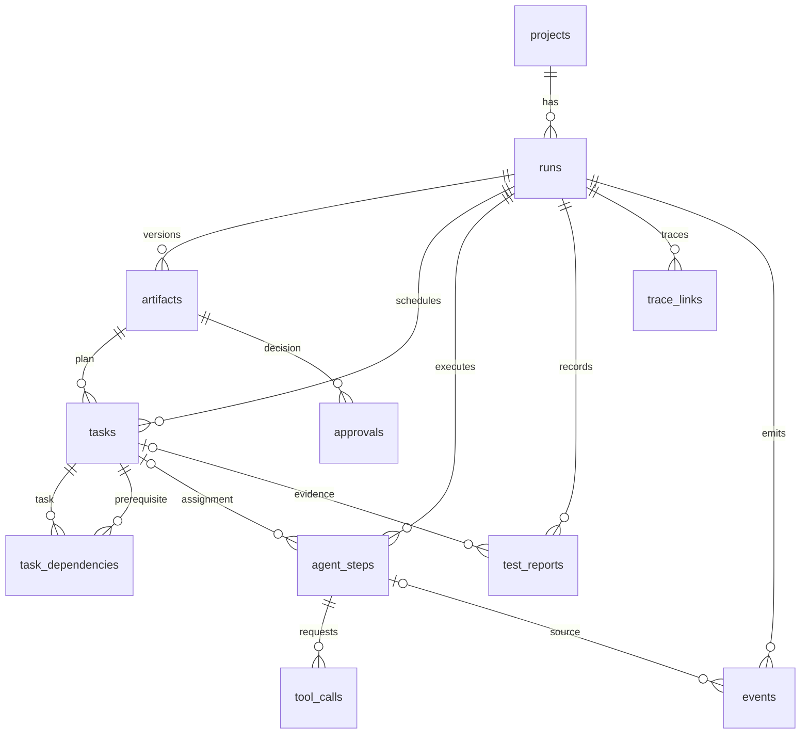

# D09 · SQLite của nền tảng

**Chủ dự án đã duyệt ERD, ràng buộc và cách nâng phiên bản của D09 trong chat.** Bản được duyệt là [7a1e95e](https://github.com/DaoNgocDinh/ChuyenDeKTPM/commit/7a1e95e). [Migration 001](../backend/migrations/001_platform.sql) triển khai 11 bảng của mục 3.8 bản Word. DB nền tảng do API và worker truy cập qua repository. Ứng dụng được sinh giữ DB nghiệp vụ trong workspace riêng. Host cung cấp các thao tác đọc/ghi định sẵn, model chỉ được dùng các tool đã cấp quyền.

| Bảng | Nội dung và khóa |
| --- | --- |
| projects | ID, tên, URI brief và thời điểm tạo. Một project có thể chạy nhiều lần. |
| runs | ID, project, khóa idempotency theo project, trạng thái, giai đoạn, cấu hình, ngân sách, lease, hạn lease, checkpoint và các mốc thời gian. Index riêng giới hạn một dòng ở trạng thái running. |
| artifacts | ID trong run, loại, phiên bản, schema, URI, SHA256, người tạo và tham chiếu cha. Mỗi bộ (run, loại, phiên bản) là duy nhất. Cập nhật nội dung tạo bản mới. |
| tasks | ID trong run, plan làm nguồn, danh sách FR, mô tả, trạng thái, số vòng sửa 0–3 và điều kiện hoàn thành. Có thể dùng cùng mã task ở các run khác. |
| task_dependencies | Cặp task và tiền nhiệm trong cùng run, có khóa ghép và cấm tự phụ thuộc. Planning kiểm tra chu trình toàn DAG trước khi ghi cả plan trong một transaction. |
| agent_steps | ID trong run, một trong sáu vai trò, task tùy chọn, lần thử, trạng thái bước, tham chiếu vào/ra và usage do adapter nhận. Usage chưa biết giữ NULL. |
| tool_calls | ID, run và bước gọi, operation ID ổn định trong run, tên tool, yêu cầu đã lọc secret, URI kết quả, trạng thái, thời gian. Ghi operation trước tác động và đối chiếu khi phục hồi. |
| approvals | ID, quyết định, ghi chú và thời điểm. Khóa ngoại ghép kiểm đúng run, ID, phiên bản và SHA256 của artifact được duyệt. Host kiểm tra phiên bản hiện hành trong cùng transaction trước khi mở cổng. |
| test_reports | ID, run, task tùy chọn, commit, suite, URI báo cáo, exit code, số pass/fail/skip/error và thời gian. Runner cung cấp bằng chứng gốc. Host đọc báo cáo để phân loại các suite rỗng hoặc lỗi hạ tầng. |
| trace_links | ID, run, loại/ID của mỗi đầu và URI bằng chứng. Host kiểm tra đầu nối đa hình theo run và phiên bản, ví dụ FR trong requirements → task → patch → test report. |
| events | ID nguyên làm cursor, run, step tùy chọn, loại, payload và thời điểm. Truy vấn theo run và ID lớn hơn cursor, sắp theo ID. |

## Đường dẫn và quyền

Host chọn root `workspaces/{project_id}/{run_id}/` bằng ID đã kiểm tra. `app/` chứa mã dự án và kho Git, `artifacts/` chứa các bản nội dung bất biến, `logs/` chứa log đã lọc. URI trong DB do host phát hành và chỉ được giải quyết bên trong run đã xác thực. Các cột JSON chứa payload nhỏ hoặc tham chiếu. File lớn nằm ở artifact store. Host rà secret trước khi ghi DB, log và gói xuất.

## Migration và giao dịch

1. Mỗi connection bật `PRAGMA foreign_keys=ON` ngay sau khi mở và trước transaction đầu tiên, rồi kiểm tra giá trị bằng 1.
2. I02 đọc `PRAGMA user_version` trước khi nhận job. Chỉ áp 001 lên DB mới ở mức 0. Nếu có dữ liệu chưa nhận diện hoặc phiên bản cao hơn khả năng của ứng dụng, dừng khởi động và báo lỗi để chủ dự án xem. Trên DB ở mức 1, bỏ qua 001. Schema tiếp theo dùng migration tăng tuần tự.
3. SQL bao cả thay đổi schema và `user_version` trong một transaction. Nếu migration lỗi, rollback transaction đang mở trước khi trả connection. Khi nâng DB đang dùng, sao lưu nhất quán và kiểm `foreign_key_check` trước khi cho worker chạy lại.
4. Gộp các thay đổi phụ thuộc nhau trong transaction ngắn, ví dụ cập nhật quyết định và trạng thái cổng hoặc ghi checkpoint và event. Giải phóng khóa trước khi gọi model, Git và runner. Host kiểm trạng thái và lease trong câu lệnh cập nhật có điều kiện để tránh hai worker nhận cùng job. Thao tác ngoài DB dùng operation ID và bước phục hồi.

**Cách test** · Từ gốc nhánh chạy `python -m unittest tests.test_platform_schema -v`. Bộ test áp migration thật lên SQLite, thử đường hợp lệ, ghi trùng, sai phiên bản/hash, nhầm run, tự phụ thuộc và lỗi migration giữa chừng. Kết quả mong đợi là cả tám ca đều đạt. [Issue D09](https://github.com/DaoNgocDinh/ChuyenDeKTPM/issues/21).
