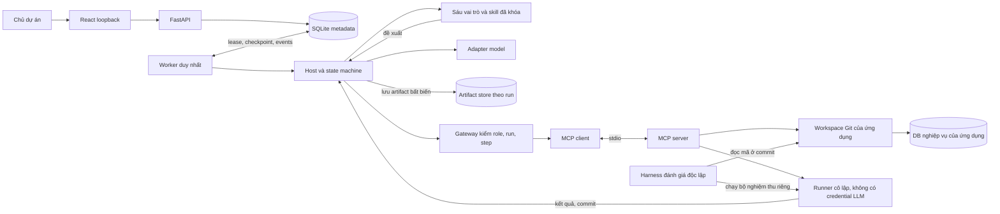
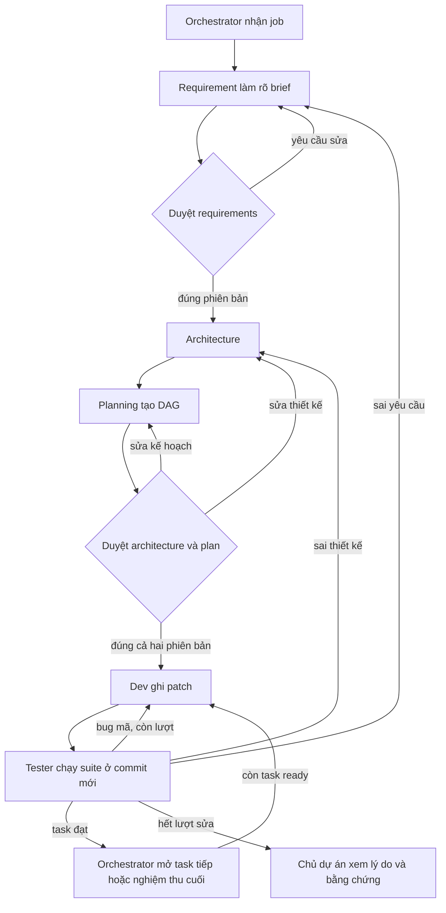

# D06 · Kiến trúc và đường đi của một run

Bản đề xuất để duyệt cùng hợp đồng vai trò D05.

### Kiểm tra bằng một fixture

1. Tạo brief A1 và khởi động run. API ghi job rồi trả ID. Worker nhận lease, Orchestrator giao Requirement. Từ chối requirements v1 vì tiêu đề rỗng chưa có tiêu chí. Kiểm tra không có bước Architecture cho tới khi duyệt v2.
2. Architecture xuất hợp đồng API/DB, Planning tạo task cho FR tiêu đề. Duyệt đúng **cả** phiên bản thiết kế và kế hoạch. Đổi một phiên bản trước khi duyệt thì host từ chối.
3. Dev đề xuất patch ở commit gốc qua Gateway/MCP. Tester chạy suite trên commit mới. Với ca mục tiêu đỏ, đính report và trả Dev. Với ca xanh và regression đạt, host mở task kế tiếp.
4. Thử ghi sang `evaluation/` từ bước Dev. Gateway từ chối và ghi sự kiện theo run. Khi vượt quota, host dừng trước tool/model call tiếp. Chủ dự án xem lý do trên timeline. Khi hủy, runner kết thúc cây tiến trình và worker lưu trạng thái.
5. Ngắt worker sau khi phát patch nhưng trước khi xác nhận. Worker mới đối chiếu operation, hash và commit với checkpoint. Nếu kết quả chưa xác định được, chuyển `pending_recovery` để chủ dự án quyết định.

`workspaces/{project_id}/{run_id}/` chứa app, artifact và log của run. SQLite nền tảng chỉ giữ metadata. Evaluation thuộc harness bên ngoài workspace mà agent được ghi. Chỉ adapter được cấp thông tin xác thực model. Runner nhận đúng mã và suite, giới hạn tài nguyên và chính sách mạng.

**Cách test** · Mở hai sơ đồ trong GitHub và lần theo năm bước fixture. Đối chiếu hai lần chờ duyệt, đường lỗi trả về vai trò và vùng được phép ghi với [hợp đồng D05](hop-dong-vai-tro.md).
